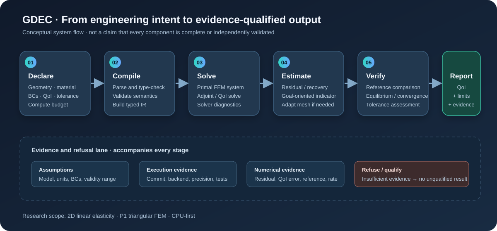
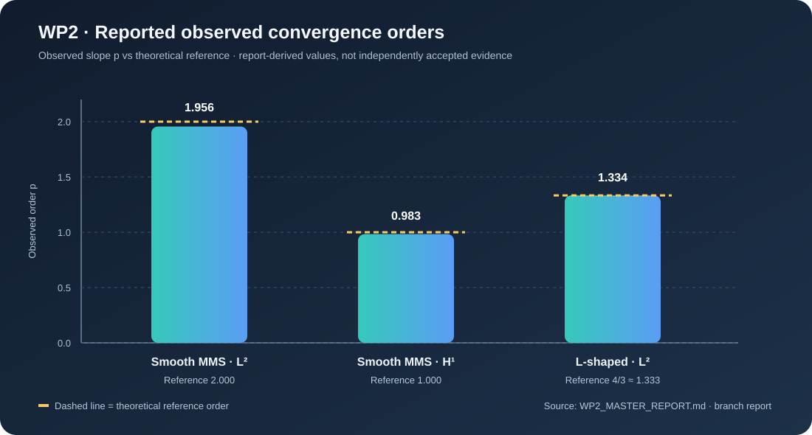

# GDEC
### Goal-Driven Engineering Computation

<p align="center">
  <strong>Engineering computation that knows what it has demonstrated — and what it has not.</strong>
  <br/>
  A research-stage, goal-oriented finite-element platform with a declarative engineering language, adaptive numerical workflows, and an evidence-first approach to computational decisions.
</p>

<p align="center">
  <a href="https://github.com/delythassociates/GDEC/actions/workflows/ci.yml"></a>
  <a href="https://github.com/delythassociates/GDEC/blob/main/LICENSE"></a>
  <a href="https://github.com/delythassociates/GDEC/releases"></a>
  <a href="https://github.com/delythassociates/GDEC"></a>
</p>

<p align="center">
  <a href="#quick-start">Quick start</a> ·
  <a href="#how-gdec-works">Architecture</a> ·
  <a href="#verification-evidence">Verification</a> ·
  <a href="#research-status">Research status</a> ·
  <a href="#contributing">Contributing</a>
</p>

---

## The problem GDEC is trying to solve

A finite-element result is not automatically an engineering answer. A solver can converge while the mesh is inadequate, a quantity of interest (QoI) can be inaccurate, or the model assumptions can be outside their valid range.

**GDEC is being developed around a stricter question:**

> What evidence supports this result, what uncertainty remains, and is that evidence sufficient for the decision being made?

The current research foundation is **2D, small-strain, linear elasticity with P1 triangular finite elements**. GDEC is not presented as a general-purpose commercial FEA replacement, and its estimators are not automatically certified error bounds.

## At a glance

| Layer | Current direction |
|---|---|
| Engineering language | Declarative `.gdc` problem descriptions and compiler validation |
| Numerical core | 2D linear-elasticity FEM, sparse linear algebra, primal/adjoint workflows |
| Error assessment | Recovery and goal-oriented estimators; estimator limitations remain explicit |
| Adaptivity | Mesh refinement and goal-aware marking workflows |
| Decision layer | Decision-sufficiency concepts, evidence and refusal architecture under development |
| Execution | CPU-first; optional CUDA work is separately gated and is not a prerequisite for core use |

## How GDEC works



1. **Declare** the engineering problem, material, constraints, target QoI and requested accuracy.
2. **Validate and compile** the specification into typed internal representations.
3. **Solve** the primal problem and, where applicable, the adjoint problem.
4. **Estimate and adapt** using the selected estimator and refinement strategy.
5. **Check** residuals, equilibrium, reference comparisons, convergence behaviour and declared limitations.
6. **Report** what was demonstrated, what remains unverified, and when the system should refuse an unqualified result.

The diagram is a conceptual view of the intended workflow, not a claim that every stage is complete or independently validated.

## Quick start

### 1. Clone and create an environment

```bash
git clone https://github.com/delythassociates/GDEC.git
cd GDEC
python -m venv .venv
```

Activate the environment:

```bash
# Linux / macOS
source .venv/bin/activate

# Windows PowerShell
.\.venv\Scripts\Activate.ps1
```

### 2. Install

```bash
python -m pip install --upgrade pip
python -m pip install -e ".[test]"
```

Optional algebraic multigrid dependencies:

```bash
python -m pip install -e ".[test,amg]"
```

### 3. Run tests and the example workflow

```bash
python -m pytest
gdec hardware
gdec validate examples/cantilever.gdc
gdec compile examples/cantilever.gdc -o results/cantilever_ir.json
gdec run examples/cantilever.gdc --strategy goal_aware
```

Check the [Actions page](https://github.com/delythassociates/GDEC/actions) for commit-specific CI results. A configured matrix is not the same thing as a successfully completed matrix; inspect the run for the exact commit and platform before treating it as evidence.

## Verification evidence

GDEC separates **software tests**, **numerical verification**, **physical validation**, and **certified error bounds**. These are different claims and must not be conflated.

| Evidence class | What it can establish | What it does not establish by itself |
|---|---|---|
| Software test | A specified code path passed an assertion in a recorded run | Mathematical correctness or physical validity |
| Numerical verification | Agreement with analytical/manufactured references, conservation identities, or justified convergence behaviour | Agreement with a real physical system |
| Physical validation | Agreement with independent experimental or trusted physical evidence | A universal guarantee outside the tested regime |
| Certified error bound | A mathematically justified upper bound under stated assumptions | Validity of the physical model itself |

### Existing verification foundations

The repository contains tests and reports for:

- Constant-strain patch behaviour and manufactured elasticity solutions.
- Global force and moment equilibrium checks.
- Cantilever-beam comparison against a Timoshenko reference.
- Rigid-body nullspace behaviour of unconstrained 2D elasticity stiffness matrices.
- Plane-stress / plane-strain mechanics and solver eligibility checks.
- Goal-oriented estimator experiments, with asymptotic/heuristic limitations distinguished from certified bounds.

Start with the [mathematical verification tests](tests/test_fem_mathematical_verification.py), [DWR verification tests](tests/test_dwr_verification.py), [iterative solver tests](tests/test_iterative_solvers.py), and [engineering status register](docs/GDEC_ENGINEERING_STATUS.md).

### WP2 convergence results — reported, pending independent closure

The WP2 branch report records the following observed orders for its convergence experiments:



| Experiment | Reported observed order | Reference order |
|---|---:|---:|
| Smooth manufactured solution, (L^2) | 1.956 | 2.000 |
| Smooth manufactured solution, (H^1) seminorm | 0.983 | 1.000 |
| Re-entrant corner, (L^2) | 1.334 | (4/3 approx 1.333) |

**Evidence status:** these values are transcribed from the WP2 execution report, not independently certified results. The WP2 review identified issues in the reference suite, mutation harness, and status-register provenance. In particular, the Kirsch case is metadata-only in the reviewed commit and the Lamé test mixes plane-stress execution with a plane-strain specification. WP2 remediation and commit-specific CI review are therefore still required before these results can be promoted as accepted verification evidence.

### Evidence links

- [WP2 master report](research/wp2/WP2_MASTER_REPORT.md)
- [WP2 acceptance matrix](research/wp2/WP2_ACCEPTANCE_MATRIX.md)
- [CI workflow definition](.github/workflows/ci.yml)
- [Reference-problem library](src/gdec/verification/reference_problems.py)
- [Convergence-order tests](tests/verification/test_convergence_order.py)
- [Known limitations](docs/known_limitations.md)

## Research status

GDEC is an **active research alpha**. The work is deliberately staged:

| Workstream | Current status |
|---|---|
| Repository integrity and project documentation | Established on the WP0 development line |
| EIR adversarial hardening | Reported by the implementation agent; independent commit-level review required |
| WP2 verification & validation suite | Implemented on a development branch; remediation findings remain open |
| WP3 evidence graph and refusal engine | Not yet closed |
| WP8 GPU batched multi-query research | Candidate only; gated behind WP2, WP3, preflight evidence and explicit owner authorization |

No GPU execution is authorized by this README. No claim of a completed WP3 evidence/refusal system or certified DWR error bounds is made here.

For the current capability-by-capability state, read [GDEC Engineering Status](docs/GDEC_ENGINEERING_STATUS.md). Treat branch reports as reported evidence until the corresponding commit, test output and CI run have been independently checked.

## Project principles

- **No silent fallback:** backend selection and actual execution must be observable.
- **No residual-only claims:** a small algebraic residual does not prove QoI accuracy.
- **No estimator overclaim:** DWR estimates are not certified bounds by default.
- **No hidden failures:** ensemble or aggregate results must disclose individual failures.
- **Traceable evidence:** claims should point to the exact tests, commit, environment and run that support them.
- **Refusal is a result:** when assumptions or evidence are insufficient, GDEC should say so.

## Documentation

- [System architecture](docs/ARCHITECTURE.md)
- [Mathematical model](docs/MATHEMATICAL_MODEL.md)
- [Language reference](docs/LANGUAGE_REFERENCE.md)
- [Engineering status register](docs/GDEC_ENGINEERING_STATUS.md)
- [Known limitations](docs/known_limitations.md)
- [Version and compatibility policy](docs/VERSION_POLICY.md)
- [Contributing](CONTRIBUTING.md)
- [Security policy](SECURITY.md)
- [Code of conduct](CODE_OF_CONDUCT.md)
- [License](LICENSE)

## Contributing

Issues and pull requests are welcome. For numerical changes, include the governing equations, assumptions, reference solution, tolerance rationale, convergence evidence, and exact test/CI run. Do not weaken an existing tolerance merely to make a test pass.

See [CONTRIBUTING.md](CONTRIBUTING.md) before opening a pull request.

---

<p align="center">
  <sub>GDEC — Goal-Driven Engineering Computation · Research alpha · Evidence before confidence.</sub>
</p>
