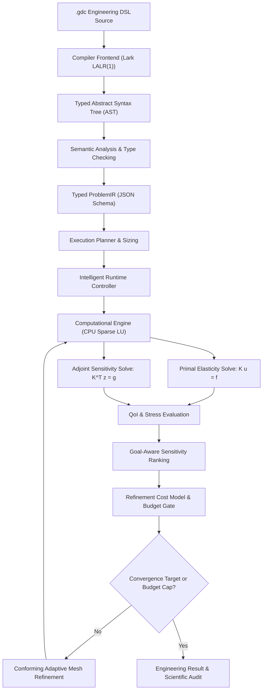

# GDEC System Architecture (v0.2.2)

## 1. High-Level Architecture Overview

Goal-Driven Engineering Computation (GDEC) inverts traditional simulation workflows. Instead of manually specifying mesh sizing, solver parameters, and ad-hoc refinement zones, the analyst specifies the physics, material, boundary conditions, target Quantity of Interest (QoI), required error tolerance, and computational budget.

## 2. Component Subsystems

### A. Compiler Subsystem (`src/gdec/language/`, `src/gdec/compiler/`)
- **Parser (`src/gdec/language/parser.py`)**: Consumes `.gdc` text via formal Lark LALR(1) grammar (`grammar.lark`). Converts CST into strongly-typed AST nodes.
- **AST (`src/gdec/language/ast.py`)**: Immutable dataclasses preserving line, column, and block coordinates for diagnostic reporting.
- **Semantic Validator (`src/gdec/language/semantic.py`)**: Enforces physical consistency (positive Young's modulus, Poisson ratio in $(-1, 0.5)$, valid boundary names, supported physics modules). Emits lowered `ProblemIR`.
- **Intermediate Representation (`src/gdec/language/ir.py`)**: Solver-independent Pydantic models supporting JSON serialization.

### B. Core Runtime Subsystem (`src/gdec/core/`)
- **Execution Planner (`src/gdec/core/planner.py`)**: Creates an initial execution plan with automated initial mesh sizing based on domain aspect ratio.
- **Cost Model (`src/gdec/core/cost_model.py`)**: Tracks historical element marking vs DOF growth. Provides conservative pre-refinement predictions to safeguard DOF limits.
- **Runtime Controller (`src/gdec/core/runtime.py`, `controller.py`)**: Coordinates the iterative solve-estimate-mark-refine loop. Implements transactional rollback if candidate refinements exceed budget.
- **Telemetry (`src/gdec/core/telemetry.py`)**: Gathers execution wall-time, peak memory, and convergence history per iteration.

### C. Finite Element Engine (`src/gdec/fem/`)
- **Mesh Management (`src/gdec/fem/mesh.py`)**: 2D conforming P1 triangular meshes wrapped around `scikit-fem.MeshTri1`. Preserves boundary facet markers during local refinement.
- **Linear Elasticity Solver (`src/gdec/fem/elasticity.py`)**: Vectorized isotropic linear elasticity assembly for plane stress and plane strain. Condensed linear system solution using SciPy sparse LU.
- **Adjoint Dual Solver (`src/gdec/fem/elasticity.py`)**: Assembles discrete dual load vector $\mathbf{g}$ and solves $\mathbf{K}^T \mathbf{z} = \mathbf{g}$. Reuses LU factorizations where possible.
- **Error Estimators (`src/gdec/fem/estimators.py`)**: Implements Zienkiewicz-Zhu (ZZ) recovery error estimator and adjoint-informed goal sensitivity indicator `goal_heuristic_v1`.
- **Adaptive Refinement (`src/gdec/fem/adaptivity.py`)**: Dörfler marking and longest-edge bisection (red-green conforming refinement) without hanging nodes.

### D. Computational Backends (`src/gdec/backends/`)
- **Backend Registry (`src/gdec/backends/registry.py`)**: Hardware inspection and backend dispatch.
- **CPU Backend (`src/gdec/backends/cpu.py`)**: Verified Sparse LU execution via NumPy / SciPy.
- **Accelerator Policy**: GPU presence is detected via CUDA/NVML for hardware diagnostics, but v0.2.2 explicitly rejects GPU execution requests to prevent unverified silent fallback.
