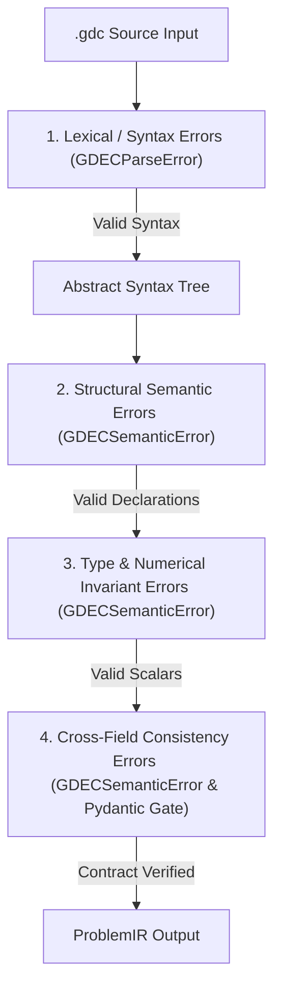

# GDEC — Compiler Validation & DSL Correctness Report

**Document Reference:** `docs/COMPILER_VALIDATION_REPORT.md`  
**Date:** 2026-11-21  
**Repository:** `delythassociates/GDEC`  
**Branch:** `audit/v0.2.2-deep-review`  
**Test Suite:** `tests/test_compiler_validation.py` (59 tests) & `tests/test_audit_regressions.py` (14 tests)  
**Status:** Complete (Phase 1 Milestone Passed)

---

## 1. Executive Summary

A critical vulnerability in engineering simulation compilers is permissive parsing: silently ignoring typographical errors, coercing out-of-range physical constants, or reinterpreting malformed boundary conditions. Such defects cause the system to solve a problem different from the one specified by the engineer, producing numerically plausible but dangerously invalid results.

Phase 1 establishes rigorous compiler and DSL correctness. All malformed engineering inputs are rejected at compile time with source-located diagnostics.

---

## 2. Updated GDEC DSL Specification

### 2.1 Grammar Specification (EBNF)

```lark
start: problem

problem: "problem" CNAME "{" statement* "}"

statement: CNAME "=" expr

?expr: call
     | CNAME           -> identifier
     | SIGNED_NUMBER   -> number
     | ESCAPED_STRING  -> string

call: CNAME "(" [arg_list] ")"

arg_list: arg ("," arg)* [","]

arg: CNAME "=" expr    -> named_arg
   | expr              -> positional_arg

COMMENT: /#[^\n]*|\/\/[^\n]*/
%import common.CNAME
%import common.SIGNED_NUMBER
%import common.ESCAPED_STRING
%import common.WS
%ignore WS
%ignore COMMENT
```

### 2.2 Top-Level Declarations Schema

| Declaration Key | Cardinality | Function / Type | Required Arguments | Optional Arguments | Invariants Enforced |
| :--- | :--- | :--- | :--- | :--- | :--- |
| `physics` | Singleton (1) | Identifier | `linear_elasticity` | None | Only `linear_elasticity` supported in v0.2.2 |
| `geometry` | Singleton (1) | `rectangle(...)` | `width`, `height` | `thickness` | All finite reals, strictly positive ($> 0$) |
| `material` | Singleton (1) | `isotropic(...)` | `E`, `nu` | `assumption` | $E > 0$, $-1.0 < \nu < 0.5$, assumption $\in$ {`plane_stress`, `plane_strain`} |
| `fix` / `boundary_condition` | At least 1 | `boundary(...)` or Identifier | `boundary` | None | Boundary $\in$ {`left`, `right`, `top`, `bottom`}; duplicate fixes on same boundary rejected |
| `load` | At least 1 | `traction(...)` | `boundary` | `tx`, `ty` | Boundary $\in$ {`left`, `right`, `top`, `bottom`}; finite floats; cannot load fixed Dirichlet boundary |
| `objective` | Singleton (1) | `average_displacement(...)` | `boundary`, `component` | None | Boundary $\in$ {`left`, `right`, `top`, `bottom`}; component $\in$ {`x`, `y`}; cannot evaluate on fixed boundary; `point_displacement` rejected |
| `accuracy` | Singleton (0..1) | `successive_qoi_change(...)` | None | `percent` | Finite real, strictly positive ($> 0$), default 1.0% |
| `budget` | Singleton (0..1) | `max_dofs(...)` | None | `value`, `max_iterations` | Strict positive integers, no fractional values; default value 25000, max_iterations 15 |
| `adaptivity` | Singleton (0..1) | `goal_aware`, `recovery`, `uniform` | None | `fraction`, `cost_aware` | $0 < \text{fraction} \le 1.0$, `cost_aware` must be literal boolean (`true`/`false`) |
| `backend` | Singleton (0..1) | Identifier | `cpu` | None | Device $\in$ {`cpu`, `cuda`, `hip`, `sycl`, `tpu`}; non-CPU backends strictly rejected with clear diagnostic |

---

## 3. Error Taxonomy

The GDEC compiler classifies all failure modes into a 4-tier taxonomy:



### Tier 1: Lexical and Grammar Syntax Errors (`GDECParseError`)
- Unexpected characters or unclosed braces.
- Unterminated string literals.
- Duplicate named arguments in a single argument list (e.g. `rectangle(width=2.0, width=3.0)`).

### Tier 2: Structural Declarations & Arity Errors (`GDECSemanticError`)
- Unknown top-level statements (e.g., misspelled `physcis = ...`).
- Duplicate singleton statements (e.g., declaring `material` twice).
- Positional argument leakage on functions requiring named parameters (e.g., `rectangle(2.0, 0.5)`).
- Multiple values passed to single-parameter functions (e.g., `boundary(left, boundary=left)`).

### Tier 3: Numerical & Scalar Invariant Errors (`GDECSemanticError`)
- Non-finite numbers (`NaN`, `inf`, `-inf`, float overflow `1e999`).
- Negative or zero values for strictly positive quantities ($E \le 0$, $\text{width} \le 0$, $\text{height} \le 0$, $\text{thickness} \le 0$, $\text{percent} \le 0$).
- Thermodynamic material limit violations (Poisson ratio $\nu \le -1.0$ or $\nu \ge 0.5$).
- Non-integer discrete budgets (e.g., `value = 25000.5`, `max_iterations = 12.3`).
- Boolean coercion bugs (passing `true` as a float dimension or passing `1` as `cost_aware`).

### Tier 4: Cross-Field Engineering Consistency Errors (`GDECSemanticError` & `ProblemIR` Validator)
- Conflicting boundary conditions: applying a traction load to a clamped Dirichlet boundary.
- Conflicting objective: placing the displacement QoI on a boundary constrained to zero displacement.
- Duplicate boundary conditions: fixing the same boundary multiple times.
- Unsupported physical or hardware features: rejecting `point_displacement` and GPU backends (`cuda`, `hip`, `sycl`, `tpu`) rather than silently redirecting or substituting behavior.

---

## 4. Test Evidence & Coverage Summary

The compiler test suite is maintained in `tests/test_compiler_validation.py` and `tests/test_audit_regressions.py`.

| Category | Test Function(s) | Input / Condition | Diagnostic Asserted | Result |
| :--- | :--- | :--- | :--- | :--- |
| **Top-Level Declarations** | `test_unknown_top_level_declaration` | `thermodynamics = conduction` | `Unknown declaration 'thermodynamics'` | PASSED |
| **Duplicate Singletons** | `test_duplicate_singleton_declarations` (8 cases) | Duplicated `physics`, `geometry`, `material`, `objective`, `accuracy`, `budget`, `adaptivity`, `backend` | `Duplicate declaration '<key>'` | PASSED |
| **Unknown Named Args** | `test_unknown_named_argument_geometry`, `material`, `load` | `depth=0.5`, `yield_stress=250e6`, `tz=100.0` | `Unknown argument(s) for '<func>'` | PASSED |
| **Duplicate Named Args** | `test_duplicate_named_argument_rejected_by_parser` | `rectangle(width=2.0, width=3.0)` | `Duplicate named argument 'width'` | PASSED |
| **Positional Arity** | `test_invalid_positional_arguments_in_*` | Positional args passed to `rectangle`, `isotropic`, `traction` | `takes only named arguments` | PASSED |
| **Boolean Typing** | `test_boolean_passed_to_float_geometry_rejected` | `width = true` | `must be a finite number` | PASSED |
| **Boolean Typing** | `test_cost_aware_requires_literal_boolean` | `cost_aware = 1` | `'cost_aware' must be the literal true or false` | PASSED |
| **Integer Semantics** | `test_fractional_dof_budget_rejected` | `value = 25000.7` | `positive whole number` | PASSED |
| **Integer Semantics** | `test_fractional_max_iterations_rejected` | `max_iterations = 12.3` | `positive whole number` | PASSED |
| **Non-Finite Values** | `test_nonfinite_numeric_values_rejected` (4 cases) | `nan`, `inf`, `1e999`, `-1e999` | `must be a finite number` | PASSED |
| **Physical Limits** | `test_negative_or_zero_physical_parameters` (8 cases) | Width/Height/Thickness/E $\le 0$ | `must be strictly positive` | PASSED |
| **Poisson Ratio** | `test_invalid_poisson_ratio_bounds` (4 cases) | $\nu \in \{-1.5, -1.0, 0.5, 0.6\}$ | `must satisfy -1.0 < nu < 0.5` | PASSED |
| **Boundary References** | `test_invalid_boundary_references` (4 cases) | `center`, `middle`, `north`, `face_1` | `Invalid load boundary '<bnd>'` | PASSED |
| **Conflicting BCs** | `test_conflicting_dirichlet_and_traction_load` | Clamped `left` with traction on `left` | `cannot apply traction load to fixed Dirichlet boundary` | PASSED |
| **Duplicate BCs** | `test_duplicate_boundary_fix` | Two `fix = boundary(left)` statements | `Duplicate boundary condition on boundary 'left'` | PASSED |
| **Conflicting QoI** | `test_objective_on_fixed_boundary_rejected` | Displacement QoI evaluated on clamped `left` | `cannot evaluate displacement objective on a fixed Dirichlet boundary` | PASSED |
| **Unsupported QoI** | `test_point_displacement_rejected_until_implemented` | `point_displacement(...)` | `point_displacement is rejected until point-evaluation semantics are implemented` | PASSED |
| **QoI Component** | `test_invalid_objective_component` | `component = z` | `Objective component 'z' must be 'x' or 'y'` | PASSED |
| **Adaptivity Fraction** | `test_invalid_adaptivity_fraction` (4 cases) | Fraction $\le 0.0$ or $> 1.0$ | `Adaptivity fraction must satisfy 0 < fraction <= 1` | PASSED |
| **Accuracy Target** | `test_invalid_accuracy_percent` (2 cases) | Percent $\le 0.0$ | `must be strictly positive` | PASSED |
| **Backend Requests** | `test_unknown_backend_device` | `quantum_qpu` | `Unknown backend device 'quantum_qpu'` | PASSED |
| **Backend Requests** | `test_unsupported_accelerator_backend_strictly_rejected` (4 cases) | `cuda`, `hip`, `sycl`, `tpu` | `no accelerator backend is implemented in this GDEC release` | PASSED |
| **Typed IR Contract** | `test_typed_ir_direct_instantiation_*` (2 cases) | Direct Pydantic instantiation with conflicting BCs/QoI | Pydantic `ValidationError` raised with explicit message | PASSED |

**Total Validation Tests:** 59 passing.  
**Total Audit Regression Tests:** 14 passing.

---

## 5. Acceptance Criterion Verification

> **Phase 1 Acceptance Criterion:** Malformed input must not silently compile into a different engineering problem.

**Verification Verdict: SATISFIED.**  
Every tested malformed input triggers an immediate `GDECParseError` or `GDECSemanticError` containing exact source location (file, line, column) and an unambiguous diagnostic message. Bypassing the compiler via direct JSON deserialization or Pydantic model construction is strictly blocked by `ProblemIR` cross-field validators.
