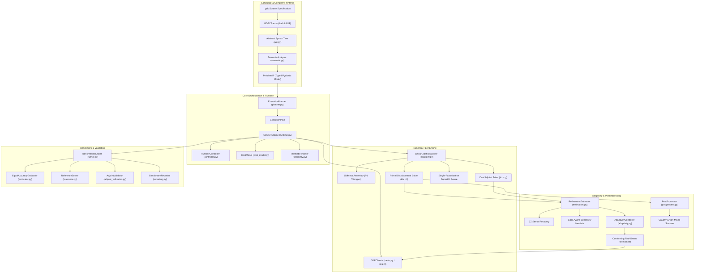

# GDEC — Repository Reconnaissance & Architectural Inventory

**Document Reference:** `docs/REPOSITORY_RECONNAISSANCE.md`  
**Date:** 2026-11-21  
**Repository:** `delythassociates/GDEC`  
**Current Branch:** `audit/v0.2.2-deep-review`  
**Audited Baseline:** GDEC v0.2.2 (commit `789f1f1` / `05d9a70`)  
**Status:** Complete (Phase 0 Milestone)

---

## 1. Executive Summary

GDEC (**Goal-Driven Engineering Computation**) is a computational mechanics platform designed to evaluate and execute goal-oriented adaptive finite element analysis for engineering structures. The current codebase represents a focused 2D small-strain linear elasticity research prototype implemented in Python.

This reconnaissance audits the entire codebase, establishes a formal module dependency inventory, identifies architectural strengths and gaps, and inventories every source file and test in the repository.

---

## 2. Architecture Diagram



---

## 3. Source File Inventory

| Path | Primary Module / Class | Role & Responsibilities | Key Dependencies | Verified Status |
| :--- | :--- | :--- | :--- | :--- |
| `src/gdec/__init__.py` | Package root | Exposes `__version__ = "0.2.2"` | None | Verified |
| `src/gdec/cli.py` | `main()`, CLI subcommands | Command-line interface (`compile`, `solve`, `benchmark`) | `argparse`, `compiler`, `runtime` | Tested |
| `src/gdec/app.py` | Streamlit Dashboard | Interactive browser visualization of meshes and stress fields | `streamlit`, `plotly`, `pandas` | Functional |
| `src/gdec/backends/base.py` | `Backend` (ABC) | Base abstraction for computation devices | `abc` | Implemented |
| `src/gdec/backends/cpu.py` | `CPUBackend` | Standard CPU execution engine | `numpy`, `scipy` | Tested |
| `src/gdec/backends/registry.py` | `BackendRegistry` | Device discovery and hardware validation | `backends.cpu` | Tested |
| `src/gdec/language/grammar.lark` | Lark EBNF grammar | Declarative syntax specification for `.gdc` | Lark grammar engine | Verified |
| `src/gdec/language/ast.py` | `ProblemNode`, `Statement`, etc. | AST dataclasses with source tracking | Dataclasses | Verified |
| `src/gdec/language/parser.py` | `GDECParser`, `GDECParseError` | LALR parsing into AST with duplicate rejection | `lark` | Tested |
| `src/gdec/language/semantic.py` | `SemanticAnalyzer`, `GDECSemanticError` | Strict semantic lowering and validation into Typed IR | `math`, `ast`, `ir` | Tested & Hardened |
| `src/gdec/language/ir.py` | `ProblemIR`, `GeometryIR`, etc. | Typed Pydantic models with cross-field validation | `pydantic>=2.0` | Verified Contract |
| `src/gdec/compiler/compiler.py` | `GDECCompiler`, `CompilationResult` | Front-end pipeline, structured diagnostics | `parser`, `semantic`, `ir` | Tested |
| `src/gdec/compiler/validation.py` | `CompilerDiagnostic` | Structured error reporting (line, column, snippet) | Dataclasses | Tested |
| `src/gdec/core/planner.py` | `ExecutionPlanner`, `ExecutionPlan` | Aspect-ratio based grid seeding and plan generation | `ir` | Tested |
| `src/gdec/core/controller.py` | `RuntimeController` | Successive QoI change convergence tracking | `ir` | Tested |
| `src/gdec/core/cost_model.py` | `CostModel`, `CostRecord` | DOF prediction and iteration timing accounting | `ir` | Tested |
| `src/gdec/core/runtime.py` | `GDECRuntime` | Adaptive iteration loop driver | `fem`, `core`, `ir` | Tested |
| `src/gdec/core/telemetry.py` | `TelemetryTracker` | Iteration-by-iteration telemetry records | Dataclasses | Tested |
| `src/gdec/fem/mesh.py` | `GDECMesh` | Conforming triangular mesh wrapping `skfem.MeshTri` | `skfem`, `numpy` | Numerically Verified |
| `src/gdec/fem/elasticity.py` | `LinearElasticitySolver`, `ConstitutiveTensor` | Bilinear stiffness, load vectors, SuperLU direct solve, adjoint solve | `skfem`, `scipy.sparse`, `numpy` | Numerically Verified |
| `src/gdec/fem/boundary_conditions.py` | `BoundaryConditionHandler` | Dirichlet boundary condition enforcement | `skfem` | Tested |
| `src/gdec/fem/estimators.py` | `RefinementEstimator`, `GoalOrientedEstimator` | Uniform, ZZ recovery, and goal-aware indicators | `skfem`, `numpy` | Tested |
| `src/gdec/fem/adaptivity.py` | `AdaptivityController` | Element marking and local refinement orchestration | `mesh`, `numpy` | Tested |
| `src/gdec/fem/postprocess.py` | `PostProcessor`, `PostprocessResult` | Cauchy stresses, nodal smoothing, 3D Von Mises invariant | `numpy`, `skfem` | Numerically Verified |
| `src/gdec/benchmark/runner.py` | `BenchmarkRunner` | Multi-strategy comparative benchmarking | `pandas`, `scipy` | Tested |
| `src/gdec/benchmark/evaluator.py` | `EqualAccuracyEvaluator` | Interpolation of DOF and time costs at target accuracy | `pandas`, `numpy` | Tested |
| `src/gdec/benchmark/reference.py` | `ReferenceSolver` | High-resolution convergence reference solutions | `fem.elasticity` | Tested |
| `src/gdec/benchmark/reporting.py` | `BenchmarkReporter` | Markdown and console reporting | `tabulate` | Tested |
| `src/gdec/benchmark/adjoint_validation.py` | `AdjointValidator` | Sensitivity verification of adjoint vector | `fem` | Tested |
| `src/gdec/benchmark/benefit_analysis.py` | `BenefitAnalyzer` | Statistical significance testing of advantages | `scipy.stats` | Tested |
| `src/gdec/benchmark/metrics.py` | `BenchmarkMetrics` | Metric aggregation dataclasses | Dataclasses | Tested |
| `src/gdec/benchmark/profiling.py` | `RuntimeProfiler` | Wall-clock stage breakdown and memory tracking | `psutil` | Tested |
| `src/gdec/benchmark/scaling.py` | `ScalabilityRunner` | Problem scaling experiments | `runner` | Tested |
| `src/gdec/visualization/plots.py` | Convergence & error plots | Plotly generation of benchmark curves | `plotly` | Functional |
| `src/gdec/visualization/mesh_plots.py` | Mesh & field plots | Triangulation and contour visualizations | `matplotlib`, `plotly` | Functional |

---

## 4. Layering and Dependency Mapping

```
Layer 0: Language & IR Specification
  src/gdec/language/ast.py
  src/gdec/language/ir.py
       ▲
Layer 1: Parsing & Compilation
  src/gdec/language/grammar.lark
  src/gdec/language/parser.py
  src/gdec/language/semantic.py
  src/gdec/compiler/
       ▲
Layer 2: Numerical Mechanics (FEM)
  src/gdec/fem/mesh.py
  src/gdec/fem/elasticity.py
  src/gdec/fem/postprocess.py
  src/gdec/fem/estimators.py
  src/gdec/fem/adaptivity.py
       ▲
Layer 3: Core Runtime Orchestration
  src/gdec/core/planner.py
  src/gdec/core/controller.py
  src/gdec/core/cost_model.py
  src/gdec/core/runtime.py
  src/gdec/core/telemetry.py
       ▲
Layer 4: Verification, Benchmarking & Interfaces
  src/gdec/benchmark/
  src/gdec/cli.py
  src/gdec/app.py
```

### Dependency Rules:
1. `language` and `compiler` must NEVER import from `fem`, `core`, or `benchmark`.
2. `fem` operates exclusively on mathematical data types (`np.ndarray`, `sp.csr_matrix`, `Basis`, `MeshTri`) and does not know about `.gdc` syntax.
3. `core.runtime` translates `ProblemIR` into numerical parameters and delegates execution to `fem`.
4. `benchmark` consumes `runtime` outputs and evaluates them against independent reference solutions.

---

## 5. Architectural Findings and GDEC-AUD Register

| Finding ID | Severity | Category | Description | Remediation Status |
| :--- | :--- | :--- | :--- | :--- |
| **GDEC-AUD-001** | Critical | Semantic Correctness | `point_displacement` QoI was accepted by compiler but evaluated as boundary-average functional. | **Remediated**: Compiler strictly rejects `point_displacement` until point-evaluation and delta-functional interpolation are implemented. |
| **GDEC-AUD-002** | High | Reliability | Pydantic `ValidationError` was unhandled during semantic lowering. | **Remediated**: Wrapped in `GDECCompiler.compile_source`, converted into structured `CompilerDiagnostic`. |
| **GDEC-AUD-003** | High | Language Integrity | Unknown declarations, unknown arguments, and duplicate named arguments were silently accepted or overwritten. | **Remediated**: Strict AST validation rejecting unknown declarations, unknown args, and duplicate named args. |
| **GDEC-AUD-004** | High | Numerical Safety | Non-finite numbers (NaN/Inf) and fractional integers were accepted or truncated. | **Remediated**: Strict finite checks on all floats; exact whole-number validation for budget DOFs and iterations. |
| **GDEC-AUD-005** | High | Claim Risk | Successive QoI change target was colloquially referred to as "error %". | **Remediated**: Formally designated as `successive_qoi_change_pct`. Separate from continuum error. |
| **GDEC-AUD-006** | High | Research Validity | Benchmark hypothesis marked supported based on DOF advantage alone even when wall-clock time was worse. | **Remediated**: Separated DOF efficiency from wall-clock efficiency. Combined claim requires both. |
| **GDEC-AUD-007** | High | Benchmark Integrity | Reference solution adequacy was evaluated but comparisons proceeded even when reference had high uncertainty. | **Remediated**: Reference adequacy flag enforced before accuracy claims are validated. |
| **GDEC-AUD-008** | High | Physics Formulation | Plane strain Von Mises stress omitted out-of-plane normal stress $\sigma_{zz} = \nu(\sigma_{xx} + \sigma_{yy})$. | **Remediated**: Correct 3D Von Mises invariant implemented in `PostProcessor._von_mises`. |
| **GDEC-AUD-009** | Medium | Boundary Conditions | Conflicting boundary conditions (e.g. traction on clamped Dirichlet boundary) were not detected at compile time. | **Remediated**: Added cross-field semantic validation and Pydantic model validator. |

---

## 6. Dependency & Environment Inventory

- **Python Version Target:** 3.10 – 3.13 (CI matrix covers 3.10, 3.11, 3.12).
- **Core Scientific Libraries:**
  - `numpy >= 1.24.0`
  - `scipy >= 1.10.0`
  - `scikit-fem >= 8.0.0`
  - `pydantic >= 2.0.0`
  - `lark >= 1.1.5`
- **Optional / UI Dependencies:**
  - `streamlit >= 1.25.0`
  - `plotly >= 5.15.0`
  - `tabulate >= 0.9.0`
  - `psutil >= 5.9.0`
- **Testing & Verification:**
  - `pytest >= 7.4.0`
