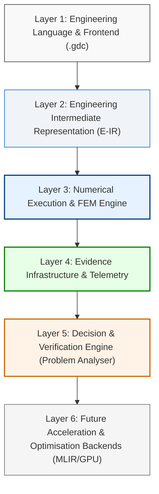
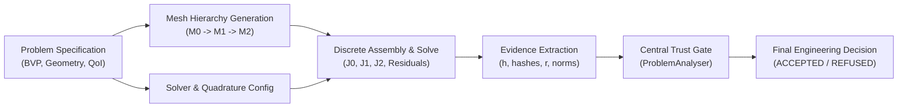

# GDEC Unified Engineering Evidence Architecture (UEEA)
**Document Version:** 1.0.0-draft  
**Target Release:** GDEC Future Architectural Foundation (Post-Phase C)  
**Status:** Design Specification Deliverable Only (Implementation Deferred)  
**Authors:** Senior Scientific Software Engineer, Computational Mechanics Researcher, Verification Specialist  

---

## 1. Executive Summary and Motivation

Traditional scientific simulation software conflates numerical computation with decision trustworthiness. Engineering finite element codes frequently produce visual contours, stress concentrations, and quantity-of-interest (QoI) evaluations without providing verifiable, machine-readable proof that:
1. The continuous mathematical boundary-value problem (BVP) is well-posed.
2. The spatial discretisation error is bounded and in the asymptotic range.
3. The algebraic solver residual is decoupled from discretisation error.
4. Numerical integration (quadrature) error does not dominate the solution.
5. The mesh sequence forms a true, nested, geometrically doubling hierarchy.

The **Unified Engineering Evidence Architecture (UEEA)** defines a formal, solver-independent, evidence-carrying computational framework for GDEC. UEEA ensures that an engineering computation is not merely a number, but an unbroken, cryptographically verifiable **Evidence Graph** culminating in an immutable **Engineering Decision Contract**.

---

## 2. Architecture Boundaries and Separation of Concerns

UEEA establishes six strict architectural layers with unidirectional dependency flow. Evidence generation is decoupled from numerical execution and solver internals.



### 2.1 Layer Responsibilities
1. **Layer 1: Engineering Language (`.gdc`):** User-facing declarative and goal-oriented specification of physical domains, governing laws, quantities of interest, and accuracy targets. Zero numerical solver semantics.
2. **Layer 2: Engineering IR (E-IR):** Solver-independent intermediate representation capturing boundary conditions, constitutive tensors, variational formulations, and functional QoI operators.
3. **Layer 3: Numerical Computation Engine (`gdec.fem`):** Pure execution core for elemental stiffness assembly, linear system condensation, and sparse matrix solving. **Strictly agnostic to verification contracts, budgets, and higher-level heuristics.**
4. **Layer 4: Evidence Infrastructure (`gdec.evidence`):** Telemetry extractors, mesh hashing utilities, quadrature sensitivity analyzers, and solver convergence inspectors.
5. **Layer 5: Verification & Decision Engine (`gdec.analyser`):** Independent trust gate evaluating convergence indices (GCI), asymptotic stability, mesh hierarchy validity, and refusal policies.
6. **Layer 6: Acceleration Backends:** Isolated hardware targets (OpenMP, CUDA, MLIR) that consume lower IR without altering evidence contracts.

---

## 3. Unified Engineering Evidence Contract (UEEC)

The **Unified Engineering Evidence Contract (UEEC)** is a versioned, machine-readable JSON schema defining the complete lifecycle of a verified engineering computation.

### 3.1 JSON Contract Specification Schema
```json
{
  "$schema": "https://gdec.org/schemas/v1/evidence_contract.json",
  "contract_id": "uuid4",
  "gdec_version": "0.3.0",
  "commit_sha": "git-hash",
  "specification": {
    "bvp_type": "linear_elasticity_2d",
    "domain_hash": "sha256-geometry-hash",
    "material": {
      "model": "isotropic_linear_elastic",
      "properties": {"E": 200e9, "nu": 0.25},
      "assumption": "plane_stress"
    },
    "boundary_conditions": {
      "dirichlet": [{"region": "left_edge", "value": [0.0, 0.0]}],
      "traction": [{"region": "top_edge", "traction": [0.0, -1000.0]}]
    }
  },
  "quantity_of_interest": {
    "functional_type": "boundary_average_displacement",
    "component": "y",
    "target_region": "top_edge",
    "scale": 1.0e-4,
    "units": "m",
    "is_supported": true
  },
  "accuracy_target": {
    "target_type": "relative",
    "requested_tolerance": 0.05,
    "qoi_scale": 1.0e-4,
    "safety_factor": 1.25
  },
  "mesh_evidence": {
    "hierarchy_type": "nested_uniform_midpoint",
    "verification_mode": "three_grid",
    "levels": [
      {
        "level_id": "M0",
        "mesh_hash": "sha256-m0",
        "elements": 50,
        "nodes": 36,
        "characteristic_h": 0.1414,
        "parent_hash": null,
        "refinement_ratio": null
      },
      {
        "level_id": "M1",
        "mesh_hash": "sha256-m1",
        "elements": 200,
        "nodes": 121,
        "characteristic_h": 0.0707,
        "parent_hash": "sha256-m0",
        "refinement_ratio": 2.0
      },
      {
        "level_id": "M2",
        "mesh_hash": "sha256-m2",
        "elements": 800,
        "nodes": 441,
        "characteristic_h": 0.0354,
        "parent_hash": "sha256-m1",
        "refinement_ratio": 2.0
      }
    ]
  },
  "solver_evidence": {
    "solver_type": "direct_sparse_lu",
    "relative_residual": 1.42e-15,
    "condition_number_estimate": 4.5e4,
    "residual_tolerance": 1.0e-10,
    "is_converged": true
  },
  "quadrature_evidence": {
    "rule": "duffy_gauss_legendre",
    "algebraic_degree": 25,
    "points_per_element": 169,
    "geometric_decay_ratio": 0.5086,
    "estimated_tail_error": 5.5e-8,
    "tail_to_discretisation_ratio": 0.0010,
    "is_negligible": true
  },
  "reference_evidence": {
    "has_reference": false,
    "reference_type": "none",
    "reference_uncertainty": null,
    "gate_threshold": 0.0005
  },
  "verification_evaluation": {
    "observed_order_p": 1.98,
    "order_used": 1.98,
    "spatial_uncertainty_U0": 1.24e-6,
    "relative_uncertainty": 0.0124,
    "asymptotic_range_confirmed": true,
    "target_attained": true
  },
  "decision": {
    "status": "ACCEPTED",
    "refusal_code": null,
    "refusal_reason": null,
    "limitations": [
      "Spatial discretisation uncertainty only (GCI)",
      "Model-form uncertainty excluded",
      "Material parameter uncertainty excluded"
    ]
  }
}
```

---

## 4. Verification Evidence Graph

Every engineering decision is backed by a directed acyclic graph (DAG) where nodes represent immutable calculation stages and edges represent cryptographic hash dependencies.



### 4.1 Evidence Node Properties
Every node in the Evidence Graph guarantees:
- `node_id`: Unique identifier (UUIDv4).
- `evidence_type`: `[GEOMETRY, MESH_HIERARCHY, RESIDUAL, QUADRATURE, ASYMPTOTIC_ORDER, DISCRETISATION_ERROR]`.
- `source_hash`: Cryptographic digest (SHA-256) of input data.
- `provenance`: Timestamp, executing engine version, hardware environment metadata.
- `status`: `[VALID, INVALID, CORRUPTED, UNVERIFIED]`.
- `dependencies`: Set of prerequisite node UUIDs.

---

## 5. Central Trust Gate Policy & Refusal Taxonomy

The Central Trust Gate operates on a **strict fail-closed policy**.

### 5.1 Trust Gate Statuses
| Status | Meaning | Action Permitted |
| :--- | :--- | :--- |
| **ACCEPTED** | All mandatory evidence obligations satisfied; asymptotic spatial convergence verified; target attained. | Production engineering sign-off, design optimization, safety compliance. |
| **QUALIFIED** | Numerical convergence verified, but secondary conditions noted (e.g. four-grid M3 stability warning with require_m3_stability=False). | Usable for exploratory design with mandatory declared limitations. |
| **REFUSED** | A mathematical, geometric, solver, or discretisation condition is violated. | Execution halted; no engineering reliance permitted; explicit refusal code returned. |
| **INCOMPLETE**| Mandatory evidence missing, corrupted, or insufficient mesh levels. | Simulation declared unverified; computation rejected. |

### 5.2 Strict Non-Compensation Principle
> **Rule:** No weighted scoring or heuristic combination may compensate for a failed critical obligation.
> If the solver residual is $10^{-4}$ (above $10^{-10}$), or the observed order $p_{\text{obs}} = 0.20$ (outside $[0.5, 3.5]$), the contract is strictly **REFUSED**, regardless of degree of refinement, mesh density, or budget remaining.

### 5.3 Distinction: Numerical Verification vs Physical Validation
- **Numerical Verification:** Proves that the discrete computer equations accurately solve the chosen continuous mathematical model ($\|u_h - u\| \le \epsilon$).
- **Physical Validation:** Proves that the chosen mathematical model accurately represents physical reality in the laboratory or field.
- **Auditor Safeguard:** An `ACCEPTED` contract certifies numerical verification only. It explicitly disclaims model-form and constitutive validity.

---

## 6. Rigorous Error and Uncertainty Separation

UEEA mandates strict conceptual and numerical separation between distinct error sources:

| Error Category | Symbol | Assessment Mechanism | Mitigation Strategy |
| :--- | :---: | :--- | :--- |
| **Algebraic Solver Residual** | $\epsilon_{\text{alg}}$ | Relative residual $\|K u_h - f\| / \|f\|$ | Preconditioned Krylov or direct sparse factorization ($< 10^{-10}$). |
| **Spatial Discretisation Error** | $\epsilon_h$ | Grid Convergence Index (GCI) on nested meshes | Systematic mesh refinement ($h \to 0$, $r=2.0$). |
| **Quadrature Truncation Error** | $\epsilon_q$ | Multi-order Duffy sensitivity ($\delta_{22,26} / (1-\rho)$) | High-order Gauss-Legendre integration ($E_{\text{tail}} \le 0.01 E_{\text{smallest}}$). |
| **Reference Solution Uncertainty**| $U_{\text{ref}}$ | Reported uncertainty of benchmark / golden artifact | Frozen reference uncertainty gate ($U_{\text{ref}} \le 0.05\%$). |
| **Model-Form Uncertainty** | $\Delta_{\text{model}}$ | Out-of-scope for verification engine | Declared limitation in contract metadata. |

> **Fundamental Axiom:** A small algebraic residual ($\|K u - f\| < 10^{-15}$) is **NEVER** proof of small discretisation error.

---

## 7. Machine-Readable Reproducibility Manifest

Every computation generates a self-contained, reproducible artifact bundle:
- **`manifest.json`**:
  - GDEC commit hash, compiler version, compiler flags.
  - Python runtime version, BLAS/LAPACK library versions, dependency hashes.
  - Hardware CPU architecture, thread count, execution timestamp.
  - Geometry hash, mesh coordinate byte hashes, element connectivity hashes.
  - Exact input parameter vectors.
- **Reproducibility Classification:**
  - `REPRODUCIBLE`: Bit-identical reproduction on identical environment.
  - `REPRODUCIBLE_WITH_ENVIRONMENT_VARIANCE`: Mathematically identical within $10^{-12}$ relative difference across different CPU/BLAS implementations.
  - `NOT_REPRODUCED`: Numerical divergence exceeding tolerance.
  - `NOT_REPRODUCIBLE`: Missing environment metadata or nondeterministic execution.

---

## 8. Deferred Implementation Plan & Architectural Roadmap

1. **Phase D (Compiler & IR Integration):** Introduce `.gdc` language parser AST nodes for `contract` and `qoi_target` keywords.
2. **Phase E (Automated Mesh Hierarchy Manager):** Integrate transactional mesh hierarchy construction into runtime execution pipelines.
3. **Phase F (Distributed Evidence Ledger):** Store verification evidence graphs in an append-only verifiable ledger for mission-critical engineering certification.
