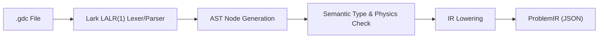

# GDEC Compiler Design & Diagnostic Pipeline

## 1. Compiler Pipeline Stages

The GDEC compiler translates `.gdc` engineering specifications into a typed Intermediate Representation (IR).

## 2. Compiler Components

### A. Parser (`src/gdec/language/parser.py`)
- Transforms token stream into syntax tree using `lark.Lark`.
- Preserves exact source location (line, column, end_line, end_column).
- Handles scientific notation (e.g., `70e9`, `1.0e-3`) and signed numbers safely without using `eval()`.

### B. Abstract Syntax Tree (`src/gdec/language/ast.py`)
- Strongly typed node classes: `ProblemNode`, `StatementNode`, `FunctionCallNode`, `ArgNode`, `LiteralNode`.
- Supports source context retrieval for user-friendly error diagnostics.

### C. Semantic Validator (`src/gdec/language/semantic.py`)
- Verifies physical admissibility:
  - $E > 0$ (positive Young's modulus).
  - $-1.0 < 
u < 0.5$ (thermodynamic stability for isotropic 2D elasticity).
  - Thickness, width, and height must be strictly positive.
  - Specified boundary names must exist in the geometry model (`left`, `right`, `top`, `bottom`).
  - Required fields (`physics`, `geometry`, `material`, `fix`, `load`, `objective`, `budget`) must be present.
  - Rejects unsupported backends (e.g., `cuda`, `gpu`) with explicit compile-time errors.

### D. Compiler Driver (`src/gdec/compiler/compiler.py`)
- Provides `compile_source(text)` and `compile_file(path)`.
- Returns `CompilationResult` containing success status, diagnostics, and lowered `ProblemIR`.
