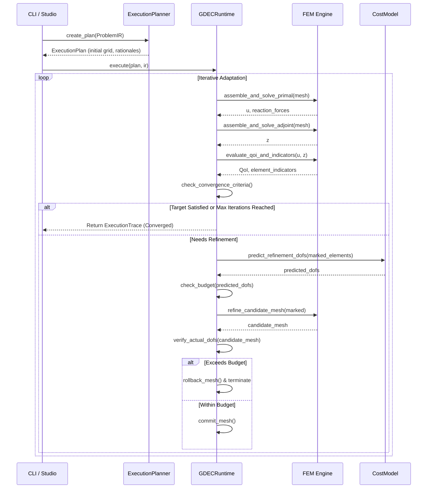

# GDEC Runtime Architecture & Execution Control

## 1. Execution Workflow

The intelligent runtime manages the execution lifecycle:

## 2. Safe Refinement Transaction Protocol

To guarantee that computational budgets are never exceeded:
1. **Pre-solve Validation**: Before executing iteration 1, the initial mesh DOFs ($N_{\text{initial}}$) are verified against $N_{\text{budget}}$. If $N_{\text{initial}} > N_{\text{budget}}$, the computation aborts immediately.
2. **Predictive Check**: The cost model estimates $\hat{N}_{k+1}$. If $\hat{N}_{k+1} > N_{\text{budget}}$, refinement is throttled or terminated.
3. **Transactional Commit/Rollback**: Mesh refinement produces a tentative candidate mesh. If the candidate mesh exceeds $N_{\text{budget}}$, the candidate is discarded, the committed mesh is retained, and the simulation terminates cleanly with `stop_reason = "Refinement halted: Next mesh would exceed DOF budget"`.

## 3. Convergence Criterion
To prevent premature termination from accidental single-step error cancellations, GDEC requires that the relative successive change satisfies the tolerance for **two consecutive iterations**:
$$\Delta J_k = \frac{|J_k - J_{k-1}|}{|J_k|} \times 100\% \le \text{target\_percent}$$
