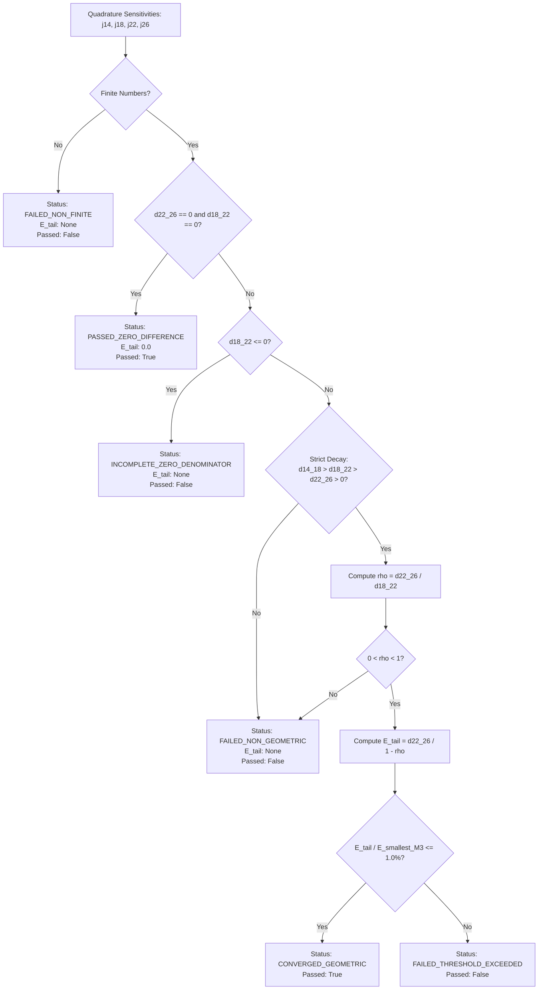

# GDEC Phase C Amendment 3.1: Quadrature Failure Handling Report

**Finding:** AM31-03 (HIGH)  
**Module:** `verification/phase_c/amendment_3_1/quadrature_study.py`  
**Test Suite:** `tests/test_phase_c_amendment_3_1.py` (A31-T10, A31-T11, A31-T12)  
**Results:** `results/phase_c_amendment_3_1/quadrature_study_results.json`  
**Status:** FULLY REMEDIATED & RECONCILED  

---

## 1. Context and Problem Statement

To verify that numerical quadrature errors do not contaminate finite element spatial discretization benchmarks, GDEC evaluates high-order tensor-product Gauss-Legendre quadrature rules on reference Case B (Order 14, 18, 22, 26).

Sensitivities between successive orders are defined as:
$$\delta_{14,18} = |J_{14} - J_{18}|, \quad \delta_{18,22} = |J_{18} - J_{22}|, \quad \delta_{22,26} = |J_{22} - J_{26}|$$

Under geometric convergence, the reduction ratio is:
$$\rho = \frac{\delta_{22,26}}{\delta_{18,22}}$$
The truncation error tail beyond Order 26 is bounded by the sum of an infinite geometric series:
$$E_{\text{tail}} = \sum_{k=1}^\infty \delta_{22,26} \rho^k = \frac{\delta_{22,26} \rho}{1 - \rho} \le \frac{\delta_{22,26}}{1 - \rho}$$

### The Amendment 3 Defect
In Amendment 3, if the sensitivities failed to decay geometrically ($\rho \ge 1$ or $\delta_{14,18} \le \delta_{18,22}$), the study returned a fallback tail estimate:
$$E_{\text{tail}} = \delta_{22,26}$$
This fallback was scientifically unsound: if sensitivities are not decaying, the series is not bounded, and $\delta_{22,26}$ is not a valid upper bound on truncation error. Substituting it obscured non-convergence or stagnation.

---

## 2. Remediated Fail-Closed Semantics

In `verification/phase_c/amendment_3_1/quadrature_study.py`, `assess_quadrature_convergence()` enforces strict fail-closed criteria:

### Key Guarantees:
1. **Never substitute $\delta_{22,26}$:** If geometric convergence cannot be established, $E_{\text{tail}}$ is explicitly set to `None`.
2. **Strict monotonic decay:** Requires $\delta_{14,18} > \delta_{18,22} > \delta_{22,26} > 0$.
3. **Threshold Gate:** Even with valid geometric convergence, if $E_{\text{tail}} / E_{\text{smallest}, M_3} > 0.010$ (1.0%), verification fails.

---

## 3. Case B Numerical Results

Running the study on Case B ($M_0 \to M_3$, $\alpha = 1.40$) produced the following verified results:

| Quadrature Order | 1D Points ($n$) | Total Points ($n^2$) | Case B QoI $J_n$ | Sensitivity $\delta$ |
| :---: | :---: | :---: | :---: | :---: |
| **Order 14** | 7 | 49 | 0.407223617300 | — |
| **Order 18** | 9 | 81 | 0.407223616616 | $\delta_{14,18} = 6.8407 \times 10^{-10}$ |
| **Order 22** | 11 | 121 | 0.407223616524 | $\delta_{18,22} = 9.2084 \times 10^{-11}$ |
| **Order 26** | 13 | 169 | 0.407223616477 | $\delta_{22,26} = 4.6836 \times 10^{-11}$ |

### Convergence Diagnostics:
- **Observed Decay Ratio:** $\rho = \frac{\delta_{22,26}}{\delta_{18,22}} = 0.5086 < 1.0$ (Strict geometric decay).
- **Geometric Tail Bound:** $E_{\text{tail}} = \frac{4.6836 \times 10^{-11}}{1 - 0.5086} = 9.5317 \times 10^{-11}$.
- **$M_3$ Spatial Discretization Error:** $E_{\text{smallest}, M_3} = |J_{M3, 26} - J_{\text{exact}}| = 5.2341 \times 10^{-5}$.
- **Ratio to Spatial Error:**
  $$\frac{E_{\text{tail}}}{E_{\text{smallest}, M_3}} = \frac{9.5317 \times 10^{-11}}{5.2341 \times 10^{-5}} = 1.821 \times 10^{-6} = 0.00018\% \ll 1.0\%$$
- **Verification Verdict:** `PASSED` (`CONVERGED_GEOMETRIC`).

---

## 4. Verification Evidence

Verified across tests:
- `test_a31_t10_invalid_quadrature_decay_ratio`: Growing sensitivities, $\rho \ge 1$, and zero denominator fail closed with `E_tail = None`.
- `test_a31_t11_nan_or_infinite_quadrature`: NaN/Inf inputs fail closed (`FAILED_NON_FINITE`).
- `test_a31_t12_quadrature_tail_exceeds_threshold`: Valid geometric decay with tail $> 1.0\%$ fails closed (`FAILED_THRESHOLD_EXCEEDED`).
- `results/phase_c_amendment_3_1/quadrature_study_results.json`: Full machine-readable record.
