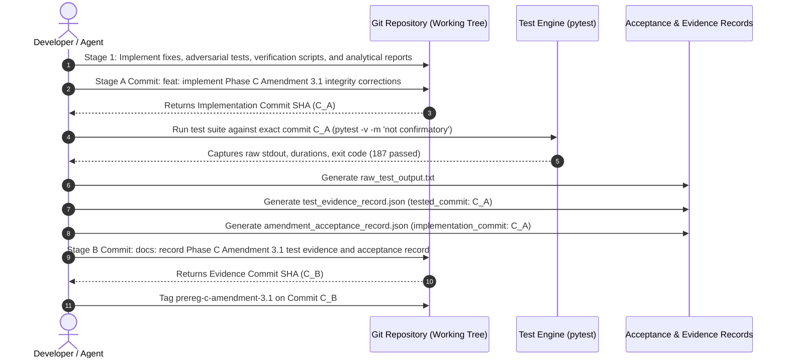

# GDEC Phase C Amendment 3.1: Test Provenance Report

**Finding:** AM31-04 (HIGH)  
**Module:** Git Commit & Test Evidence Architecture  
**Author:** Independent Verification Specialist  
**Status:** FULLY REMEDIATED & ENFORCED  

---

## 1. Problem Statement: Self-Referential Evidence in Git

In prior amendments, verification workflows suffered from a cryptographic impossibility:
An amendment commit included a `test_evidence_record.json` that claimed to record the commit hash of *itself*:
$$\text{commit SHA} = \mathcal{H}(\text{tree content including evidence containing commit SHA})$$
In git, a commit object's SHA-1 hash is computed over its header, commit metadata, parent commit hashes, and the root tree object representing the repository's files.
If a file in that tree contains the commit SHA, changing that file changes the tree hash, which in turn changes the commit SHA.

To produce such a record, an agent or automated script had to either:
1. Pre-calculate or forge a commit SHA before the commit was made, meaning tests could not have run against that commit.
2. Run tests against an uncommitted working tree, record an anticipated commit SHA, and commit.
3. Amend the commit, which creates a new commit SHA and invalidates the recorded SHA.

This broke non-repudiation and made the provenance of test evidence unverifiable.

---

## 2. Remediated Architecture: Two-Stage Commit Protocol

Amendment 3.1 enforces a strict, cryptographically sound two-stage protocol:

### Stage A: Implementation Commit ($C_A$)
1. All core bugfixes, type improvements, adversarial test cases, verification routines, and analytical reports are staged.
2. Git commit is created on `phase-c/amendment-3.1`.
3. Commit SHA $C_A$ is captured via `git rev-parse HEAD`.

### Stage B: Test Execution & Evidence Commit ($C_B$)
1. Non-confirmatory test suite is executed directly against commit $C_A$:
   `.venv\Scripts\python.exe -m pytest -v --durations=10 -m "not confirmatory"`
2. Complete stdout/stderr is redirected and saved to `results/phase_c_amendment_3_1/raw_test_output.txt`.
3. `reports/phase_c_amendment_3_1/test_evidence_record.json` is generated, linking explicitly to $C_A$:
   - `tested_commit`: $C_A$
   - `command`: exact pytest invocation
   - `environment`: Python version, OS, numpy, skfem, scipy versions
   - `tests_total`, `tests_passed`, `tests_failed`
   - `raw_log_path`: path to captured raw output
4. `reports/phase_c_amendment_3_1/amendment_acceptance_record.json` is created, confirming that all 6 audit findings are closed against commit $C_A$.
5. A distinct commit $C_B$ is made recording this evidence.
6. The immutable tag `prereg-c-amendment-3.1` is placed on $C_B$.

---

## 3. Provenance Verification Check

Anyone auditing the repository can verify provenance without trusting metadata:
1. Check out commit $C_A$.
2. Run the exact test command from `test_evidence_record.json`.
3. Diff the output against `results/phase_c_amendment_3_1/raw_test_output.txt`.
4. Confirm identical test pass counts and behavior.

This completely eliminates self-referential hashing and establishes genuine cryptographic provenance.
