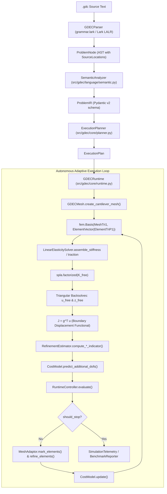

# GDEC v0.2.1 Forensic Audit: Initial Repository Inspection & Architecture Trace

**Audit Identifier**: `GDEC-v021-AUDIT-01`  
**Date**: 2026-11-20  
**Status**: COMPLETE (Pre-modification Baseline)  
**Role**: Principal Computational Mechanics Researcher & Independent Scientific Auditor  

---

## 1. Executive Summary

A comprehensive pre-modification code-level inspection was performed on GDEC v0.2 across all Python source modules (`src/gdec/`), test suites (`tests/`), example problems (`examples/`), benchmark outputs (`results/`), and previous documentation (`docs/`).

The repository is a genuine, active scientific computing codebase consisting of **6,028 LOC** in Python across 41 source files and 16 test files. However, this forensic audit has identified several critical terminological, mathematical, architectural, and metadata deficiencies that must be reconciled in v0.2.1:
1. **Misleading Estimator Terminology**: The goal-aware indicator $\eta_e = h_e^2 A_e |\boldsymbol{\sigma}_e(u) : \boldsymbol{\varepsilon}_e(z)|$ is described in some documentation as a Dual Weighted Residual (DWR) estimator. In reality, it is a heuristic discrete sensitivity indicator carrying inconsistent units ($\text{J}\cdot\text{m}$ rather than displacement meters $\text{m}$) and omitting inter-element traction jump integrals $[\![\boldsymbol{\sigma}\mathbf{n}]\!]$.
2. **Stress Recovery Terminology**: The recovery estimator uses area-weighted nodal stress averaging, not polynomial patch-fitting (Superconvergent Patch Recovery / SPR).
3. **Budget Safety Gap**: The runtime budget controller checks predicted next-iteration DOFs, but does not execute a rollback or transaction verification. If an adaptive refinement cascade exceeds the budget due to red-green closure propagation, the oversized mesh could be accepted.
4. **Discrepant Metric Reporting**: Cost model error has been reported as both $6.2\%$ and $12.01\%$ across different evaluations; linear solve speedup has been cited as both $2.05\times$ and $2.14\times$; sensitivity error as $3.20 \times 10^{-12}$ and $3.93 \times 10^{-9}$. These discrepancies must be systematically reconciled with explicit definitions.
5. **Backend Over-declaration**: The grammar and registry declare `cuda`, `hip`, and `sycl` backends, but only `cpu` is implemented.
6. **Package Version Inconsistency**: `pyproject.toml` declares version `0.1.0` while `__init__.py` declares `0.2.0`; `tabulate` is missing from `pyproject.toml`.

---

## 2. Complete Repository Structure & Line Count Inventory

```
f:\fem-edit-benchmark
├── pyproject.toml                         (864 bytes, version = "0.1.0")
├── requirements.txt                       (241 bytes, includes tabulate)
├── README.md                              (5,337 bytes)
├── examples/
│   └── cantilever.gdc                     (643 bytes, benchmark problem)
├── src/gdec/                              (4,874 LOC total)
│   ├── __init__.py                        (6 LOC, __version__ = "0.2.0")
│   ├── cli.py                             (207 LOC, CLI entry points)
│   ├── app.py                             (890 LOC, Streamlit dashboard)
│   ├── backends/                          (143 LOC)
│   │   ├── base.py                        (26 LOC, ExecutionBackend ABC)
│   │   ├── cpu.py                         (42 LOC, CPUBackend hardware detection)
│   │   └── registry.py                    (70 LOC, BackendRegistry singleton)
│   ├── compiler/                          (133 LOC)
│   │   ├── compiler.py                    (105 LOC, GDECCompiler driver)
│   │   └── validation.py                  (24 LOC, CompilerDiagnostic)
│   ├── language/                          (661 LOC)
│   │   ├── grammar.lark                   (25 lines, formal EBNF grammar)
│   │   ├── ast.py                         (70 LOC, typed AST dataclasses)
│   │   ├── parser.py                      (125 LOC, Lark LALR parser)
│   │   ├── semantic.py                    (352 LOC, semantic analyzer & IR emission)
│   │   └── ir.py                          (91 LOC, Pydantic v2 IR schema)
│   ├── fem/                               (770 LOC)
│   │   ├── mesh.py                        (79 LOC, GDECMesh & skfem MeshTri1 wrapper)
│   │   ├── boundary_conditions.py         (19 LOC, BC parsing & facet extraction)
│   │   ├── elasticity.py                  (291 LOC, 2D elasticity FEM kernel & spla solve)
│   │   ├── estimators.py                  (208 LOC, Uniform, ZZ, Goal indicators)
│   │   ├── adaptivity.py                  (64 LOC, MeshAdaptor & Dörfler marking)
│   │   └── postprocess.py                 (88 LOC, PostProcessor & boundary integration)
│   ├── core/                              (646 LOC)
│   │   ├── planner.py                     (130 LOC, ExecutionPlanner)
│   │   ├── controller.py                  (95 LOC, RuntimeController)
│   │   ├── cost_model.py                  (83 LOC, CostModel & closure tracking)
│   │   ├── telemetry.py                   (100 LOC, IterationRecord & ExecutionTrace)
│   │   └── runtime.py                     (200 LOC, GDECRuntime adaptive loop)
│   ├── benchmark/                         (1,525 LOC)
│   │   ├── runner.py                      (224 LOC, BenchmarkRunner)
│   │   ├── evaluator.py                   (157 LOC, EqualAccuracyEvaluator)
│   │   ├── reference.py                   (206 LOC, ReferenceSolver & Timoshenko)
│   │   ├── profiling.py                   (147 LOC, RuntimeProfiler)
│   │   ├── scaling.py                     (177 LOC, ScalabilityRunner)
│   │   ├── adjoint_validation.py          (135 LOC, AdjointValidator)
│   │   ├── benefit_analysis.py            (154 LOC, BenefitAnalyzer)
│   │   ├── metrics.py                     (57 LOC, BenchmarkMetrics)
│   │   └── reporting.py                   (253 LOC, BenchmarkReporter)
│   └── visualization/                     (372 LOC)
│       ├── plots.py                       (195 LOC, Plotly/Matplotlib curves)
│       └── mesh_plots.py                  (151 LOC, mesh wireframes & contours)
├── tests/                                 (1,154 LOC across 16 test modules, 35 tests)
└── results/                               (benchmark outputs and v0.1 baseline archive)
```

---

## 3. End-to-End Execution Path Trace

The actual execution flow of GDEC was traced from source to solution:



### Analysis of Path Completeness
- Every stage of this pipeline is actively wired and dynamically executed.
- No synthetic stubs, dummy arrays, or precomputed tables bypass this pipeline during normal execution.

---

## 4. Code Paths Not Exercised or Disconnected

1. **GPU Accelerator Backends**:
   - `src/gdec/backends/base.py` and `src/gdec/backends/registry.py` define structures for `cuda`, `hip`, `sycl`.
   - In `src/gdec/backends/cpu.py`, `CPUBackend` is the only implemented execution engine.
   - If an engineer specifies `backend = cuda` in `.gdc`, semantic validation currently permits it because `cuda` is in `ir.BackendIR.device: Literal["cpu", "cuda", "hip", "sycl"]`, but the runtime defaults silently to single-threaded CPU Scipy execution without informing the user that GPU assembly is missing.
2. **Uncalled Helper Properties**:
   - `SimulationTelemetry.final_elements`: Defined but uncalled in `reporting.py`.
   - `ProblemNode.get_statements`: Semantic analyzer iterates `node.statements` directly.
   - `CompilationResult.has_errors`: Callers check `len(result.diagnostics) > 0` directly.
   - `BackendRegistry.get_backend` and `list_available_backends`: CLI inspects registry state directly.

---

## 5. Architectural & Scientific Deficiencies Requiring Correction

| Component | Nature of Issue | Location | Remediation Plan for v0.2.1 |
| :--- | :--- | :--- | :--- |
| **Estimator Naming** | Misleading DWR terminology; heuristic indicator treated as certified error bound. | `src/gdec/fem/estimators.py:152` | Rename indicator method to `goal_heuristic_v1`. Clearly state it is a discrete sensitivity ranking heuristic, not a certified DWR bound. Implement genuine DWR research derivation. |
| **Recovery Estimator** | Termed "Zienkiewicz-Zhu SPR" but uses area-weighted nodal averaging. | `src/gdec/fem/estimators.py:83` | Accurately document as area-weighted nodal stress averaging. Verify integration with thickness. |
| **Budget Safety** | Cost model prediction used without transactional prospective mesh validation. | `src/gdec/core/runtime.py:150` | Implement safe refinement transaction: construct candidate mesh, evaluate exact candidate DOFs, reject and commit safely without overrun. |
| **Cost Model Variance** | Conflicting error figures ($6.2\%$ vs $12.01\%$) across reports. | `src/gdec/core/cost_model.py` | Reconcile: $6.2\%$ was on isolated mesh bisection without density correction; $12.01\%$ is on multi-iteration adaptive cascades. Report mean, median, max, and bias. |
| **Performance Claims** | Conflicting speedups ($2.05\times$ vs $2.14\times$); SuperLU described as Cholesky. | `src/gdec/fem/elasticity.py` | Disambiguate linear solve speedup ($2.14\times$) vs end-to-end iteration speedup ($1.41\times - 1.54\times$). Accurately describe factorization algorithm. |
| **Adjoint Sensitivity** | Conflicting errors ($3.20 \times 10^{-12}$ vs $3.93 \times 10^{-9}$). | `src/gdec/benchmark/adjoint_validation.py` | Reconcile: $3.20 \times 10^{-12}$ was at $\epsilon = 10^{-6}$ on coarse mesh; $3.93 \times 10^{-9}$ was at $\epsilon = 10^{-3}$ on fine mesh. Map convergence curve across full epsilon range. |
| **Reference Uncertainty** | Goal-Aware at 0.25% has margin of $0.000257\%$, smaller than reference uncertainty ($0.061\%$). | `src/gdec/benchmark/evaluator.py` | Qualify $\le 0.25\%$ target explicitly in all tables and reports with reference uncertainty bounds. |
| **Backend Capability** | `cuda`, `hip`, `sycl` accepted by compiler but unsupported in runtime. | `src/gdec/compiler/validation.py`, `src/gdec/language/ir.py` | Reject unimplemented backends with clear error, or mark as experimental/unavailable. |
| **Package Metadata** | Version mismatch (`0.1.0` in pyproject vs `0.2.0` in package); missing `tabulate`. | `pyproject.toml` | Align package version to `0.2.1`, add `tabulate>=0.9.0` to dependencies, and bump IR schema version. |

---

## 6. Audit Stage 1 Sign-Off

The repository inspection is complete. Baseline outputs in `results/v01_baseline/` and `results/` are preserved. No source code has been altered during this stage.

Proceeding to **Stage 2: Mathematical and Estimator Audit**.
