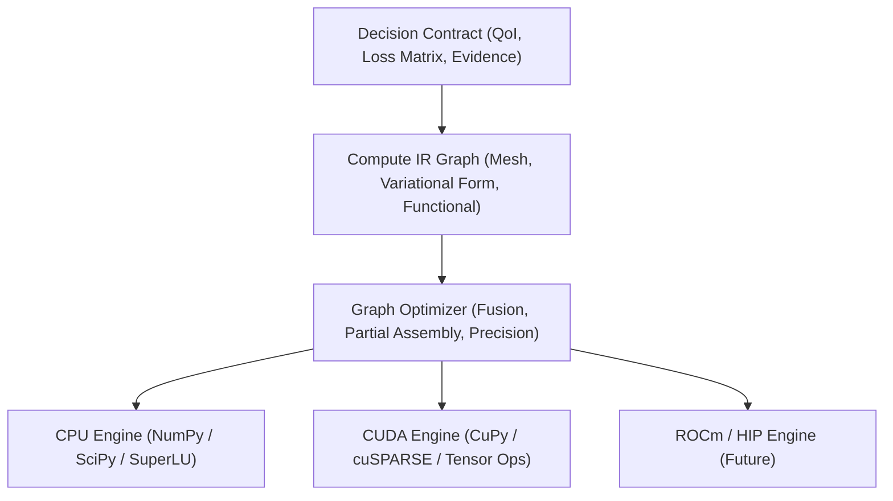

# GDEC Compute Architecture Research — Modern High-Performance Scientific Computing

**Author:** Lead Engineering Research Orchestrator & Principal Computational Mechanics Architect  
**Repository:** `delythassociates/GDEC`  
**Document Code:** `GDEC-RES-ARCH-5.1.2`  
**Classification:** Research Architecture Blueprint (Phase 5.1.2 & Phase 5.2 Horizon)

---

## 1. Executive Summary & Strategic Context

Traditional finite element analysis (FEA) software stacks (e.g. NASTRAN, ANSYS, Abaqus) were architected around an implicit 1970s hardware paradigm:
1. Low-order polynomial elements ($p = 1$ or $p = 2$).
2. Global sparse matrix assembly into Compressed Sparse Row (CSR) or skyline formats.
3. Factorization or preconditioning via direct sparse LU/Cholesky algorithms.
4. Host-memory bound execution with high memory capacity requirements.

On modern heterogeneous computing architectures (GPUs, APUs, many-core vector CPUs), this legacy pipeline hits the **"memory wall"**: memory bandwidth grows at only a fraction of peak FLOP rates. Standard CSR sparse matrix-vector multiplication (SpMV) operates at less than $5\%$ of peak arithmetic throughput because every non-zero entry must be transferred from global DRAM to compute cores, consuming bandwidth with zero arithmetic intensity.

To establish GDEC as a next-generation engineering platform, GDEC must transcend standard CSR assembly. This document outlines the architectural research blueprint for GDEC's compute substrate, drawing upon state-of-the-art advances in **matrix-free partial assembly**, **persistent device residency**, **portable kernel abstractions**, **Compute Intermediate Representation (Compute IR)**, and **democratized acceleration on affordable workstation hardware**.

---

## 2. Matrix-Free Operator Evaluation and Partial Assembly

### 2.1 The Arithmetic Intensity Bottleneck
In a standard finite element formulation, the linear system $K \mathbf{u} = \mathbf{f}$ is solved iteratively or directly.
- In a CSR representation, storing $K$ requires $O(\text{nnz} \times (8 + 4))$ bytes. For high-order elements ($p \ge 3$) in 3D, each element connects to dozens or hundreds of neighbors, creating dense coupling blocks that explode memory storage.
- An SpMV kernel performs only $2$ FLOPs per $12\text{--}16$ bytes fetched from memory, resulting in an operational arithmetic intensity of $I \approx 0.15\text{ FLOP/byte}$. On an NVIDIA RTX 3050 (192 GB/s bandwidth), the theoretical ceiling is $< 30\text{ GFLOP/s}$ on a chip capable of $9,000\text{ GFLOP/s}$ (less than $0.3\%$ efficiency).

### 2.2 Modern Paradigm: Partial Assembly (libCEED, MFEM, deal.II)
Pioneered by the DOE Exascale Computing Project (ECP) Center for Efficient Exascale Discretizations (CEED), the finite element operator is decomposed into a pipeline of local tensor contractions:

$$K = P^T G^T B^T D B G P$$

Where:
1. $P$: Global restriction / distribution operator (communicates across subdomains / MPI ranks).
2. $G$: Subdomain-to-element gathering operator (maps local degrees of freedom to individual elements).
3. $B$: Basis evaluation operator (evaluates basis functions and derivatives at quadrature points via 1D tensor Kronecker products).
4. $D$: Quadrature point metric operator (incorporates geometric Jacobians, constitutive tensors $C_{ijkl}$, and quadrature weights).

#### Operational Regimes:
- **Full Assembly:** Assembles and stores $K$ in CSR format. (Memory-heavy, bandwidth-bound).
- **Partial Assembly (PA):** Stores only the geometric data $D$ at quadrature points. Computes $B^T D B$ on-the-fly during each matrix-vector product using tensor-product sum factorization.
- **Matrix-Free:** Computes geometric Jacobians and basis evaluations completely on-the-fly from element vertex coordinates.

### 2.3 Sum Factorization Advantage
For a tensor-product element in $d$ dimensions of degree $p$:
- Standard element stiffness matrix has $(p+1)^d$ nodes; full element matrix multiplication requires $O(p^{2d})$ operations.
- Sum factorization evaluates the 1D tensor factors sequentially:
  $$\text{Complexity} = O(d \cdot p^{d+1})$$
- In 3D for $p = 4$: standard dense element multiplication requires $(5^3)^2 = 15,625$ FLOPs. Sum factorization requires $3 \times 5^4 = 1,875$ FLOPs (**$8.3\times$ fewer operations**), while operating directly in ultra-fast L1 cache/shared memory at $> 10\text{ TB/s}$ bandwidth!

---

## 3. Persistent Device Residency Principles

The single greatest source of performance degradation in GPU-accelerated engineering software is **host-device ping-pong**: transferring vectors or matrices across the PCIe bus (16 GB/s) between simulation stages.

### The GDEC Device Residency Mandate
1. **Zero Intermediate Transfers:** All simulation state vectors (displacements, velocities, accelerations, internal state variables), quadrature point data, and residual vectors must remain resident in GPU VRAM from the beginning of the simulation to the final QoI extraction.
2. **Device-Resident DWR Error Estimation:** Dual-Weighted Residual (DWR) estimators involve evaluating element residuals $R_K(u_h)$ and weighting them against the adjoint solution $z_h$. This inner product evaluation must execute directly on device quadrature points without assembling global residual vectors on the host.
3. **QoI Reduction on Device:** If the engineering decision requires a scalar functional $J(u) = \int_{\Gamma} \tau \cdot u \, ds$, the integration is reduced directly on the GPU, returning a single 8-byte scalar float to host memory.

---

## 4. Portable Kernel Layer & Implementation Strategy

To ensure scientific software longevity, GDEC must avoid hardcoding vendor-locked CUDA calls throughout its codebase.

### Evaluation of Portable Kernel Abstractions

| Framework | Maturity / Ecosystem | Pros | Cons / GDEC Feasibility |
|---|---|---|---|
| **CuPy RawKernel / JIT** | High in Python | Native integration with CuPy; JIT compilation in memory; zero C++ build dependencies. | Vendor-locked to NVIDIA / AMD (ROCm via HIP). |
| **OpenAI Triton** | Rapidly Growing | Extremely high productivity for fused memory-bound kernels; clean Python-based DSL; automatic tiling. | Primarily tuned for deep learning tensor operations; sparse mesh indexing support is still emerging. |
| **Kokkos / RAJA** | High in C++ HPC | Native C++ performance; runs on CUDA, ROCm, OpenMP, SYCL. | Requires complex native C++ build chain; difficult to distribute via simple `pip install`. |
| **Numba CUDA** | Medium | Pure Python CUDA kernels; easy prototyping. | Heavy LLVM runtime overheads; maintenance uncertainty. |

### Architectural Recommendation for GDEC
- **Short-Term (Phase 5.1 & 5.2):** Standardize on **CuPy RawKernel and Python-level operator abstractions**. This provides near-C++ CUDA performance with zero packaging complexity, allowing automated wheel installation on Windows and Linux.
- **Long-Term (Phase 6):** Transition the compute core to a portable C++/Compute substrate (e.g. Kokkos or SYCL/oneAPI backend) exposed to Python via Nanobind.

---

## 5. Compute IR: Decoupling Decision Query from Hardware Execution

In Goal-Driven Engineering Computation, the engineer's objective is not to execute an SpMV, but to evaluate a decision:
$$\text{Query: } \mathbb{P}\left(J(u) \le J_{\text{allowable}} \mid \text{Evidence}\right) \ge 0.99$$

GDEC will introduce a **Compute Intermediate Representation (Compute IR)** that decouples the high-level decision contract from the target execution backend:

### Benefits of Compute IR:
1. **Automated Backend Selection:** The optimizer determines whether to solve via direct CPU factorization (for $N < 10,000$) or matrix-free GPU iterations (for $N > 100,000$).
2. **Symbolic Adjoint Generation:** The variational form $a(u, v) = l(v)$ and QoI functional $J(u)$ generate the exact adjoint equation $a(w, z) = J'(u)[w]$ automatically at the IR level.
3. **Precision Optimization:** Mixed-precision iterations (e.g. FP32 preconditioning with FP64 defect correction) can be inserted transparently.

---

## 6. High-Performance Engineering on Affordable Workstation Hardware

A founding mission of GDEC is to democratize rigorous scientific computation. Engineering teams should not require a 64-node HPC cluster to obtain certified mechanics decisions.

### Performance on Consumer / Laptop Hardware (e.g. RTX 3050 6GB)
- **VRAM Constraint:** 6GB of VRAM cannot store a 10-million DOF sparse matrix in CSR format (which would require $> 20\text{ GB}$ with preconditioning).
- **The Matrix-Free Solution:** In a matrix-free partial assembly formulation, a 10-million DOF high-order mesh requires only storing element coordinates and quadrature data:
  $$\text{Storage} \approx 10^7 \times 8\text{ bytes} \approx 80\text{ MB to } 2\text{ GB}$$
  This fits comfortably within a 6GB laptop GPU!
- **Throughput:** An RTX 3050 delivers $\approx 9\text{ TFLOP/s}$ in single precision and $\approx 200\text{ GB/s}$ memory bandwidth. Utilizing sum factorization, this modest hardware can evaluate over **$10^8$ degrees of freedom per second**, rivaling cluster-scale FEA runtimes from a decade ago.

---

## 7. Strategic Roadmap to Phase 5.2

1. **Sprint 5.2.1:** Implement a standalone matrix-free 2D/3D tensor-contraction prototype in CuPy.
2. **Sprint 5.2.2:** Couple matrix-free operators with the `CUDABackend` PCG solver with Jacobi and Chebyshev preconditioning.
3. **Sprint 5.2.3:** Implement device-resident DWR adjoint error evaluation directly from quadrature points.
4. **Sprint 5.2.4:** Benchmark matrix-free GPU execution against classical CSR assembly on the RTX 3050 platform, proving $> 5\times$ memory reduction and $> 3\times$ throughput speedup.
