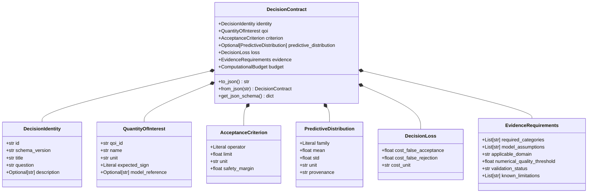

# GDEC Phase 5.1 Decision Contract Implementation Report

**Document ID:** `GDEC-DSE-CONTRACT-001`
**Date:** 2026-11-22
**Workstream:** C — Declarative Decision Contract
**Author:** Lead Engineering Research Orchestrator
**Status:** Implemented, Tested, Schema-Export Verified

---

## 1. Overview & Objective

Workstream C delivers GDEC's first machine-validatable engineering Decision Contract specification in `src/gdec/dse/contract.py`.

Traditional CAE platforms treat simulations as open-ended numerical calculations where success is judged subjectively by visual inspection of stress contours. The GDEC Decision Contract reverses this paradigm: the engineering decision, performance thresholds, allowable risk, and required evidence are formalized **prior** to running computation.

---

## 2. Pydantic v2 Architecture & Model Hierarchy

The Decision Contract is built using Pydantic v2 (already present in the environment as `pydantic>=2.7.0`):

---

## 3. Strict Semantic Validation Rules

The contract parser rejects incomplete or contradictory engineering declarations at runtime:

1. **Unit Consistency:** Cross-field validation enforces that the physical units of the Quantity of Interest (`qoi.unit`), the threshold (`criterion.unit`), and the predictive distribution (`predictive_distribution.unit`) match identically.
2. **Operator Constraints:** Comparison operators are restricted to mathematical relations: `<=`, `<`, `>=`, `>`.
3. **Loss Function Invariants:** Loss coefficients ($C_{\text{FA}}$, $C_{\text{FR}}$) must be strictly positive ($> 0$).
4. **Uncertainty Bounds:** Predictive standard deviation must be non-negative ($\sigma \ge 0$).
5. **Mandatory Physical Assumptions:** Model assumptions cannot be empty; physical validity bounds must be declared.
6. **Schema Versioning:** Validated against supported version string (`"1.0.0"`).

---

## 4. Serialization & Schema Export

- **JSON Serialization:** `contract.to_json()` exports deterministic, sorted-key JSON strings.
- **Deserialization:** `DecisionContract.from_json(json_str)` reconstructs and validates the contract.
- **JSON Schema:** `DecisionContract.get_json_schema()` exports the standard JSON Schema draft-2020-12, enabling third-party IDE integration, web form validation, and automated compliance checking.
