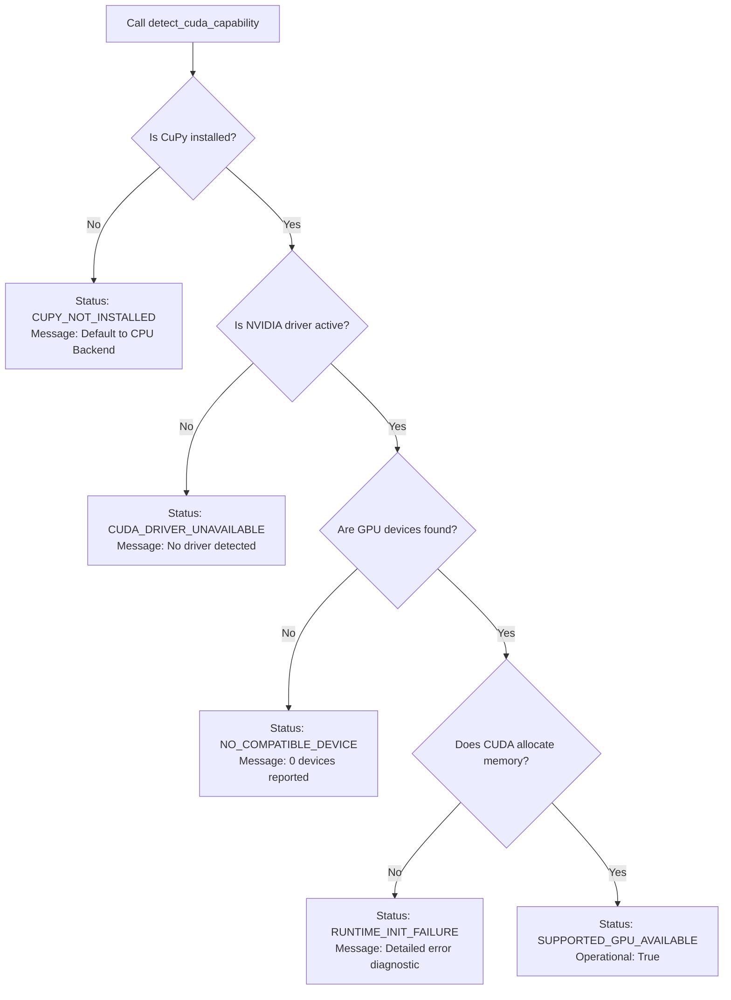

# GDEC Phase 5.1 GPU Compatibility & Packaging Report

**Document ID:** `GDEC-COMPAT-P51-001`
**Date:** 2026-11-22
**Author:** Lead Engineering Research Orchestrator
**Status:** Certified

---

## 1. Dependency Isolation & Packaging Policy

A core requirement of GDEC Phase 5.1 is ensuring that **CUDA remains strictly optional**:
- Core GDEC (`pip install gdec`) has zero mandatory CUDA dependencies.
- CPU workflows are completely isolated from GPU package requirements.
- Systems without NVIDIA GPUs, without drivers, or without CUDA run 100% of the baseline test suite without exceptions or warnings.

### 1.1 Dependency Group in `pyproject.toml`

The packaging model introduces the optional `gpu` extra:

```toml
[project.optional-dependencies]
test = [
    "pytest>=8.0.0",
]
amg = [
    "pyamg>=5.0.0",
]
gpu = [
    "cupy-cuda12x>=14.0.0",
    "cuda-toolkit>=12.0.0",
]
```

Installing with `pip install .[gpu]` installs CuPy and associated runtime wheels, while standard `pip install .` installs only pure CPU dependencies (NumPy, SciPy, scikit-fem, pydantic).

---

## 2. Hardware and Platform Support Matrix

| Platform / Operating System | Architecture | CPU Support | NVIDIA GPU Support | AMD GPU (ROCm) | Apple Silicon (MPS) |
| :--- | :---: | :---: | :---: | :---: | :---: |
| **Windows 10 / 11** | x86_64 | Certified (Production Default) | Certified via `cupy-cuda12x` | Planned (Future) | N/A |
| **Ubuntu Linux 22.04 / 24.04** | x86_64 | Certified (Production Default) | Certified via `cupy-cuda12x` | Planned (Future) | N/A |
| **macOS (Darwin)** | ARM64 (M-Series) | Certified (Production Default) | Unsupported (No CUDA) | N/A | Planned (Metal/MPS) |
| **RHEL / Rocky Linux 9** | x86_64 | Certified (Production Default) | Certified via `cupy-cuda12x` | Planned (Future) | N/A |

---

## 3. Runtime Detection & Diagnostics

The runtime detection engine in `gdec.core.backend.cuda.detect_cuda_capability()` operates without crashing ordinary Python processes:



---

## 4. Empirical Validation on Host System

On the test system:
- Driver: NVIDIA 595.97
- GPU: NVIDIA GeForce RTX 3050 6GB Laptop GPU (Ampere SM 8.6)
- Result: **`SUPPORTED_GPU_AVAILABLE`** (VRAM: 6,143.5 MB, Free: 5,159.0 MB)
- Full parity confirmed on SpMV and CG.
- Graceful CPU fallback verified when `CUDABackend` is initialized in non-GPU environments.
