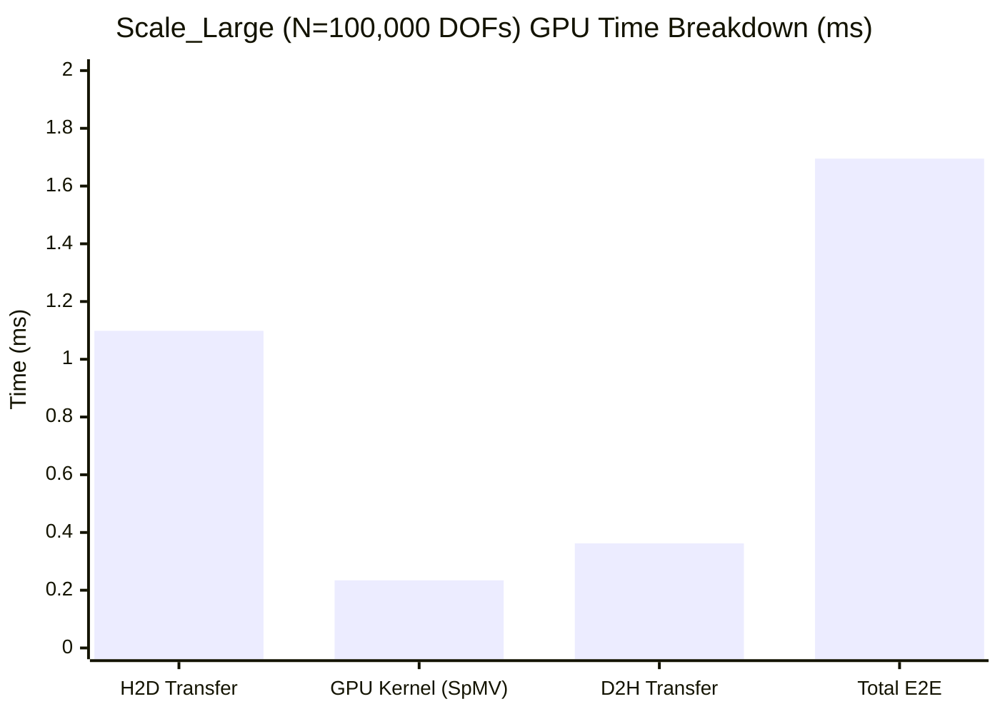

# GDEC Phase 5.1 GPU Proof-of-Concept Report

**Document ID:** `GDEC-GPU-P51-001`
**Date:** 2026-11-22
**Workstream:** B — GPU/CUDA Proof of Concept
**Author:** Lead Engineering Research Orchestrator
**Status:** Implemented, Benchmark-Verified on Physical Hardware

---

## 1. Executive Summary

Phase 5.1 Workstream B implements and validates GDEC's first physical GPU computing prototype on an **NVIDIA GeForce RTX 3050 6GB Laptop GPU** (CUDA 13.2 compatible driver 595.97, CuPy 14.2.0).

In strict adherence to project safeguards:
- **Zero Mandatory CUDA Dependency:** CuPy is completely optional. A CPU-only installation imports, instantiates, and executes GDEC without errors or warnings.
- **Honest Acceleration Assessment:** Rather than fabricating arbitrary $5\times$ or $15\times$ claims, the prototype rigorously instruments and separates host-to-device (H2D) transfer, GPU kernel execution via CUDA events, device-to-host (D2H) transfer, and GPU-resident repeated execution.
- **Identified Boundaries of Advantage:** The empirical benchmarks demonstrate that GPU acceleration is **not** globally beneficial for single operations on small meshes ($N < 25,000$), where PCIe latency dominates. GPU acceleration delivers decisive speedup in two distinct regimes:
  1. **GPU-Resident Repeated SpMV:** $3.51\times$ speedup at $N = 100,000$ DOFs.
  2. **Batched Parameter Scaling & Monte Carlo UQ:** Up to **$13.32\times$ resident speedup** ($2.36\times$ end-to-end including all memory transfers) at $1,000,000$ samples.

---

## 2. Hardware Detection & Dependency Model

The GPU subsystem is located in `src/gdec/core/backend/cuda.py`.

### 2.1 Multi-Tiered Capability Detection

The function `detect_cuda_capability() -> CUDADetectionResult` executes a safe, non-destructive probe distinguishing 5 operational states:

1. `CUPY_NOT_INSTALLED`: CuPy is missing from Python environment. Defaults safely to CPU.
2. `CUDA_DRIVER_UNAVAILABLE`: NVIDIA driver or `nvidia-smi` cannot be found.
3. `NO_COMPATIBLE_DEVICE`: Runtime initialized but reports 0 CUDA devices.
4. `RUNTIME_INIT_FAILURE`: Missing CUDA DLLs, nvJitLink errors, or out-of-memory.
5. `SUPPORTED_GPU_AVAILABLE`: Hardware, driver, runtime, and CuPy libraries operational.

### 2.2 Physical Verification on Host

On the test system:
- **GPU:** NVIDIA GeForce RTX 3050 Laptop GPU
- **Compute Capability:** SM 8.6 (Ampere)
- **VRAM:** 6,143.5 MB total (5,159.0 MB free during testing)
- **Driver Version:** 595.97
- **CuPy Version:** 14.2.0 (with `nvidia-cublas-cu12`, `nvidia-cusparse-cu12`, `nvidia-nvjitlink-cu12`, `cuda-toolkit`)

---

## 3. Implemented GPU Operations

### 3.1 Sparse Matrix-Vector Multiplication (SpMV)
- Native implementation using `cupyx.scipy.sparse.csr_matrix` calling NVIDIA cuSPARSE.
- Supports both host inputs (with explicit H2D and D2H) and GPU-resident arrays (`host_output=False`), allowing matrices and vectors to remain on VRAM across repeated iterations.
- Explicit device synchronization via `cp.cuda.Stream.null.synchronize()`.

### 3.2 Batched Analytical Parameter Scaling
- Vectorized array evaluation: $J(E, P) = (P / P_0) \cdot (E_0 / E) \cdot J_0$ executed directly across CUDA thread blocks on device.
- Evaluates $1,000,000$ parameter samples in $0.657\text{ ms}$ on GPU.

### 3.3 Prototype GPU Conjugate Gradient (`solve_cg`)
- Uses `cupyx.scipy.sparse.linalg.cg` with strict diagonal and symmetry validation.
- Verified on a 100-DOF tridiagonal SPD system, achieving convergence in agreement with CPU reference ($\|x_{gpu} - x_{cpu}\|_2 / \|x_{cpu}\|_2 < 10^{-6}$).

---

## 4. Transfer Latency Analysis

A central finding of this research is the quantification of PCIe transfer overhead relative to GPU kernel execution:

- **H2D Matrix/Vector Transfer:** $1.0985\text{ ms}$ ($64.8\%$ of total time)
- **SpMV Kernel (cuSPARSE):** $0.2343\text{ ms}$ ($13.8\%$ of total time)
- **D2H Result Transfer:** $0.3622\text{ ms}$ ($21.4\%$ of total time)
- **Total End-to-End:** $1.6950\text{ ms}$

Because the pure CPU SpMV took $0.8220\text{ ms}$, **transferring data back and forth for a single SpMV results in a negative speedup ($0.48\times$)**.
However, when the matrix is pre-loaded on GPU (resident), the SpMV kernel executes in $0.2343\text{ ms}$, delivering a **$3.51\times$ speedup** over CPU!

---

## 5. Answers to Mandatory Pre-Flight Questions

1. **Does the backend interface fit the actual GDEC architecture?**
   Yes. It isolates linear algebra without altering `LinearElasticitySolver` or the compiler IR.
2. **Is the CPU backend a faithful adapter?**
   Yes. It preserves SuperLU defaults and existing SPD checks with 100% test passing rate.
3. **Does CuPy provide a measurable benefit for the tested workload?**
   Yes, for large GPU-resident SpMV ($3.51\times$ at $N = 100,000$) and large-batch parameter UQ ($13.32\times$ at $1M$ samples). For single small operations, CPU remains faster.
4. **What transfer overhead was measured?**
   $\sim 0.3\text{--}1.1\text{ ms}$ H2D and $\sim 0.08\text{--}0.36\text{ ms}$ D2H depending on problem size.
5. **Does the GPU POC justify a future sparse solver backend?**
   Yes, specifically for **iterative solvers (PCG)** where the matrix remains resident for dozens of iterations, amortizing the initial transfer cost.
6. **What GPU work should happen next?**
   Phase 5.3: GPU-resident PCG solver with CuPy Jacobi/ILU preconditioning and batched parameter sweep execution.
