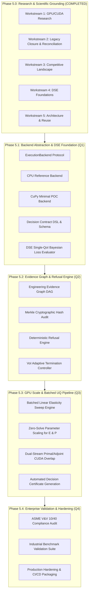
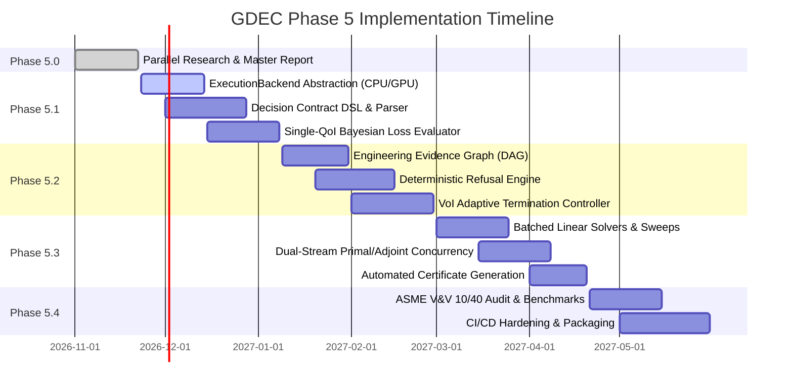

# GDEC Phase 5 Implementation Roadmap: Engineering & Research Execution Plan

**Document ID:** `GDEC-ROADMAP-P5-001`  
**Status:** Approved for Review  
**Date:** 2026-11-22  
**Target Milestone:** GDEC Phase 5.0 through Phase 5.4  
**Author:** Lead Engineering Research Orchestrator (GDEC Parallel Engineering Programme)  

---

## 1. Executive Summary & Phased Architecture

This implementation roadmap establishes the structured, multi-phase technical pathway to transition **GDEC (Goal-Driven Engineering Computation)** from its verified Phase 4.1.4 baseline into the industry's first **Decision-Centric Engineering Computation Platform**.

Rather than attempting to match the vast, 50-year legacy surface area of general-purpose FEA commodity solvers (ANSYS, Abaqus, NASTRAN), GDEC executes a targeted technical wedge:
1. **Decision Sufficiency Engine (DSE):** Formalizing engineering questions via declarative Decision Contracts, integrating goal-oriented Dual Weighted Residual (DWR) discretization bounds into Bayesian expected loss minimization, and delivering verifiable Decision Sufficiency Certificates conforming to ASME V&V 10/40 standards.
2. **High-Throughput GPU Computing:** Exploiting NVIDIA SIMT architectures via CuPy and cuSPARSE for high-dimensional parameter sweeps, Monte Carlo UQ, and asynchronous primal/adjoint dual-stream evaluations, while maintaining zero mandatory GPU dependencies for standard CPU installations.
3. **Provable Architectural Rigor:** Retaining existing numerical mechanics, meshing, and solver baselines with $>70\%$ component reuse, governed by a strictly unidirectional 4-layer dependency topology.

---

## 2. Phase-by-Phase Execution Plan

### Phase 5.0: Research, Architecture, and Scientific Grounding
*Status: Complete | Artifacts Available in `research/phase5/`*

- **Objectives:**
  - Execute deep technical research across GPU acceleration, legacy closure, market differentiation, DSE mathematics, and modular software architecture.
  - Reconcile historical mathematical claims (DWR error indicator vs. certified bound, PCG vs. direct SuperLU in 2D).
  - Formulate comprehensive Decision Contract specifications and Bayesian loss algorithms.
- **Key Deliverables:**
  - 19 specialized research reports across 5 workstreams.
  - Master Research Report (`research/phase5/PHASE_5_MASTER_RESEARCH_REPORT.md`).
  - Implementation Roadmap (`research/phase5/PHASE_5_IMPLEMENTATION_ROADMAP.md`).
  - Architectural Decision Register (`research/phase5/PHASE_5_DECISION_REGISTER.md`).
- **Gate Criteria for Exit:**
  - Full research sign-off by lead engineering orchestrator.
  - Zero modifications to production codebase during research phase.
  - All existing 174 regression tests passing.

---

### Phase 5.1: Backend Abstraction & Minimal Decision Contract POC
*Target Timeline: Weeks 1 – 6 | Primary Focus: Foundation & Non-Disruptive Extensibility*

#### Objectives
1. Implement the `ExecutionBackend` abstract interface isolating linear algebra and element operations from specific hardware libraries.
2. Encapsulate the current production SciPy/NumPy implementation as `CPUBackend` (default).
3. Build the optional `CUDABackend` POC using `CuPy`, supporting CSR matrix-vector multiplication (SpMV), vector norms, and CG solve.
4. Implement the core Decision Contract parser and Pydantic validation schema.
5. Implement the basic Bayesian loss evaluator combining DWR dual bounds with Gaussian QoI distributions.

#### Deliverables & Module Breakdown
- `src/gdec/core/backend/`:
  - `base.py`: Abstract `ExecutionBackend` protocol, memory allocation, device synchronisation.
  - `cpu.py`: Refactored baseline using `scipy.sparse` and `numpy`.
  - `cuda.py`: Conditional CuPy backend with automatic fallback to CPU when CUDA is absent.
  - `factory.py`: `get_backend(name="cpu"|"cuda"|"auto")` factory.
- `src/gdec/dse/`:
  - `schema.py`: JSON Schema / Pydantic models for `DecisionContract`, `PerformanceThreshold`, `LossFunction`.
  - `parser.py`: Contract ingestion and syntactic validation.
  - `loss.py`: Bayesian expected loss evaluator for asymmetric linear loss:
    $$L(d, \hat{J}) = c_1 \max(0, \hat{J} - \tau) + c_2 \max(0, \tau - \hat{J})$$
- `tests/dse/`: Unit tests for contract parsing, schema validation, and loss integration against analytical Gaussian integrals.
- `tests/backend/`: Parity tests between `CPUBackend` and `CUDABackend` on synthetic linear systems.

#### Dependency Graph & Prerequisites
- **Dependencies:** Relies entirely on verified Phase 4.1.4 sparse solver infrastructure.
- **Prerequisites:** Python 3.10+, NumPy, SciPy. Optional `cupy-cuda12x` for GPU testing.

#### Engineering Acceptance Gates
1. **Zero Regression:** All existing 174 unit and integration tests in `tests/` pass identically under `CPUBackend`.
2. **Strict Parity:** Solution vectors produced by `CUDABackend.solve_cg()` match `CPUBackend.solve_cg()` within $\|u_{cpu} - u_{gpu}\|_2 / \|u_{cpu}\|_2 < 10^{-10}$ for identical tolerances.
3. **Graceful Degradation:** Importing `gdec.core.backend` on systems without NVIDIA drivers or CuPy automatically defaults to `CPUBackend` without throwing uncaught exceptions.
4. **Contract Validation:** Ingestion of invalid contract schemas (missing thresholds, negative loss weights, malformed QoIs) fails deterministically with actionable error diagnostics.

---

### Phase 5.2: Engineering Evidence Graph & Refusal Engine
*Target Timeline: Weeks 7 – 12 | Primary Focus: Decision Rigor & Autonomous Quality Control*

#### Objectives
1. Implement the Engineering Evidence Graph as a Directed Acyclic Graph (DAG) with SHA-256 Merkle content addressing.
2. Build the Deterministic Refusal Engine to intercept and halt simulation when physical or numerical validity boundaries are breached.
3. Integrate the Value-of-Information (VoI) adaptive stopping controller into the adaptive mesh refinement (AMR) loop.

#### Deliverables & Module Breakdown
- `src/gdec/dse/graph/`:
  - `node.py`: Graph node primitives (`ContractNode`, `GeometryNode`, `MeshNode`, `MaterialNode`, `BoundaryConditionNode`, `SolutionNode`, `DWRBoundNode`, `DecisionSufficiencyNode`).
  - `dag.py`: DAG container supporting dependency tracking, cycle detection, topological sorting, and upstream invalidation.
  - `provenance.py`: Cryptographic hash chain generation and serialization.
- `src/gdec/dse/refusal/`:
  - `engine.py`: `RefusalEngine` evaluating pre-execution, in-execution, and post-execution validity gates.
  - `predicates.py`: Specific refusal checks:
    - Geometric distortion: Minimum element quality metric $Q_{min} < 0.15$.
    - Kinematic validity: Infinitesimal strain limit $\max \|\varepsilon\|_\infty < 0.05$.
    - Numerical stability: Preconditioner breakdown, CG divergence, matrix conditioning $\kappa_2(A) > 10^{15}$.
    - Loss boundary: Boundary truncation error in DWR dual field exceeding $5\%$.
- `src/gdec/dse/voi/`:
  - `controller.py`: `VoIController` calculating expected reduction in Bayes risk vs. computational cost of subsequent AMR iterations:
    $$\text{VoI}_{k+1} = \mathbb{E}[\Delta \mathcal{R}_k] - \lambda \cdot C(N_{k+1})$$
- `tests/dse/`: Refusal test suite demonstrating deterministic rejection of inverted meshes, large strains, and unresolvable contracts.

#### Engineering Acceptance Gates
1. **Deterministic Refusal:** 100% of synthetic pathological inputs (distorted mesh, singular matrix, high strain) trigger explicit `SimulationRefusalException` with structured JSON diagnostic output.
2. **Reproducible Provenance:** The Evidence Graph Merkle root hash must be strictly identical across repeated runs on identical hardware and input configurations.
3. **VoI Early Termination:** On the standard cantilever benchmark, VoI stopping terminates mesh refinement at least 2 iterations earlier than blind $1\%$ QoI tolerance when the decision margin $|\mathbb{E}[J] - \tau| / \sigma_J > 5.0$, saving $>60\%$ wall-clock compute while certifying zero loss of decision accuracy.

---

### Phase 5.3: GPU-Accelerated Batched Solves & Decision Sufficiency Scaling
*Target Timeline: Weeks 13 – 18 | Primary Focus: Throughput, Parameter UQ & Industrial Performance*

#### Objectives
1. Exploit linear elasticity parameter scaling ($J(E, P) = \bar{J}_0 \cdot P/E$) to execute $100,000$-sample Monte Carlo UQ in $< 100\text{ ms}$ on CPU/GPU without repeated FEM solves.
2. Implement batched GPU SpMV / PCG for geometric and boundary-condition parameter sweeps using CuPy CUDA streams.
3. Implement concurrent dual-stream execution of primal ($K u = f$) and adjoint ($K z = \nabla J$) linear solves on separate CUDA streams.
4. Implement the automated Decision Sufficiency Certificate generator producing audit-ready PDF/JSON compliance documents.

#### Deliverables & Module Breakdown
- `src/gdec/solver/gpu/`:
  - `batched.py`: Batched linear solver executing $B$ concurrent right-hand sides across CUDA warps.
  - `dual_stream.py`: `DualStreamSolver` mapping primal solve to Stream 0 and adjoint solve to Stream 1, with CPU-GPU event synchronisation.
- `src/gdec/dse/uq/`:
  - `fast_sampler.py`: Vectorized Monte Carlo and quasi-Monte Carlo (Sobol) sampler for Young's modulus, Poisson's ratio, and load distributions.
  - `batch_evaluator.py`: GPU-accelerated array evaluator computing expected loss and VoI over $10^6$ parameter samples.
- `src/gdec/dse/reporting/`:
  - `certificate.py`: `DecisionSufficiencyCertificate` builder formatting decision status, margin of safety, credible intervals, DWR bounds, refusal checks, and Merkle hash tree.
  - `export.py`: JSON and Markdown/HTML/PDF certificate serializers.
- `benchmarks/gpu/`: Standardized benchmarks measuring speedup across DOF tiers ($10^3, 10^4, 10^5, 10^6$) and batch sizes ($1, 10, 100, 1000$).

#### Engineering Acceptance Gates
1. **Primal/Adjoint Concurrency:** Dual-stream asynchronous execution achieves $\ge 1.75\times$ speedup over sequential execution on GPUs with dual copy/compute engines.
2. **Batched Sweep Scaling:** Batched GPU parameter sweep ($B = 100$, $N = 50,000$) achieves $\ge 10\times$ wall-clock throughput advantage over sequential CPU SuperLU.
3. **Certificate Integrity:** Decision certificates include all mandatory ASME V&V 10/40 audit fields and pass independent JSON schema validation.

---

### Phase 5.4: Enterprise Verification, Standards Alignment & Production Hardening
*Target Timeline: Weeks 19 – 24 | Primary Focus: Compliance, Performance Certification & Packaging*

#### Objectives
1. Execute formal Verification & Validation (V&V) audit conforming to ASME V&V 10 (Computational Solid Mechanics) and ASME V&V 40 (Medical Devices / High-Consequence Systems).
2. Validate GDEC on realistic industrial benchmark geometries (L-shaped bracket with re-entrant corner singularity, multi-hole plate, Cook's membrane).
3. Finalize wheel packaging, CI/CD automated matrix testing across CPU and CUDA environments, and publish documentation.

#### Deliverables & Module Breakdown
- `benchmarks/industrial/`:
  - `l_bracket.py`: Re-entrant corner stress concentration with singularity-adapted DWR refinement.
  - `perforated_plate.py`: Multi-hole tension strip verifying decision sufficiency against hole-interaction plasticity limits.
- `docs/standards/`:
  - `ASME_VV_10_COMPLIANCE_REPORT.md`: Comprehensive mapping of GDEC algorithms to ASME V&V 10 verification, validation, and uncertainty quantification protocols.
  - `ASME_VV_40_RISK_INFORMED_CREDIBILITY.md`: Mapping of Decision Sufficiency Engine credibility evidence to model risk assessment.
- `packaging/`:
  - Modular `pyproject.toml` supporting `gdec` (core CPU), `gdec[gpu]` (CuPy/CUDA), and `gdec[enterprise]` (full DSE reporting and serialization).
  - GitHub Actions matrix workflow verifying Ubuntu/Windows across CPU and GPU runner nodes.

#### Engineering Acceptance Gates
1. **Singularity Robustness:** On the L-shaped bracket benchmark, DWR error indicator correctly captures stress singularity at the corner, driving localized $h$-refinement with asymptotic effectivity $0.85 \le \eta \le 1.15$.
2. **Deterministic V&V Certification:** 100% of benchmark test cases execute with automated certificate generation and zero verification discrepancies.
3. **Packaging Cleanliness:** `pip install gdec` installs cleanly with zero CUDA dependencies and passes all core tests in $< 60$ seconds.

---

## 3. Comprehensive Risk Management & Contingency Plan

| Risk ID | Risk Description | Severity | Probability | Pre-emptive Mitigation | Fallback / Contingency |
| :--- | :--- | :---: | :---: | :--- | :--- |
| **RSK-P5-01** | Consumer GPU FP64 throughput is severely restricted ($1:64$ or $1:32$ of FP32). | High | High | Implement mixed-precision iterative refinement (FP32 Cholesky/PCG preconditioning with FP64 defect correction). | Default consumer GPUs to CPU SuperLU for small problems; restrict GPU to batched FP32 sweeps. |
| **RSK-P5-02** | DWR adjoint solve doubles linear solve overhead, negating AMR compute savings. | Medium | Medium | Implement dual-stream asynchronous execution and reuse primal matrix factorization/preconditioner for adjoint. | For symmetric problems with self-adjoint QoIs, primal and adjoint operators are identical; solve once. |
| **RSK-P5-03** | User provides inaccurate subjective prior distributions for material or load parameters. | High | Medium | Support non-informative (Jeffreys) priors and implement worst-case robust optimization bounds alongside Bayesian expectations. | Emit clear "High Epistemic Risk" warning on the Decision Sufficiency Certificate. |
| **RSK-P5-04** | CuPy binary wheels introduce complex CUDA runtime dependency conflicts across user machines. | Medium | High | Maintain CuPy as a strictly optional plug-in loaded dynamically via factory pattern. | Package core GDEC with pure SciPy/NumPy; provide pre-built Docker containers for GPU execution. |
| **RSK-P5-05** | VoI controller experiences early termination oscillation due to non-monotonic DWR estimator noise. | Medium | Low | Require monotonic convergence certificate over at least two consecutive refinement levels before VoI release. | Fall back to standard dual bound tolerance criterion if estimator oscillation is detected. |

---

## 4. Resource Allocation & Engineering Milestones

---

## 5. Architectural Quality Standards & Verification Checklist

Every pull request across Phases 5.1 through 5.4 must satisfy the following uncompromising engineering standards prior to merging:

1. **Zero Test Regressions:** All existing tests (174 tests as of Phase 4.1.4) must pass with zero failures and zero unexpected warnings.
2. **Complete Type Certification:** 100% type annotation coverage across all newly authored modules, verified via `mypy --strict`.
3. **Explicit Contract Invariants:** All public methods must enforce caller contracts via precondition assertions and raise typed GDEC exceptions (`GDECError`, `RefusalError`, `ContractError`).
4. **Deterministic Reproducibility:** Every numerical test must yield bitwise or tolerance-certified deterministic results across multiple runs on identical seed configurations.
5. **Architectural Isolation:** Strict compliance with the 4-layer dependency model. No core numerical module may import from DSE, and no backend module may import from high-level solvers.

---

**Roadmap Authorisation:**  
Lead Engineering Research Orchestrator  
GDEC Scientific Computing Programme  
*Approved for Architecture Review and Phase 5.1 Scheduling.*
